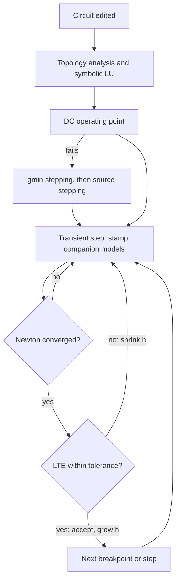
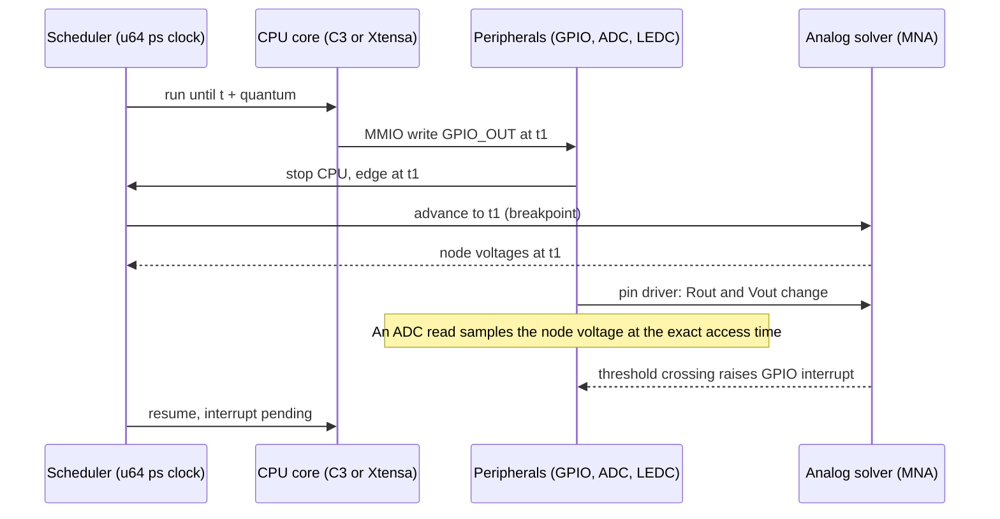
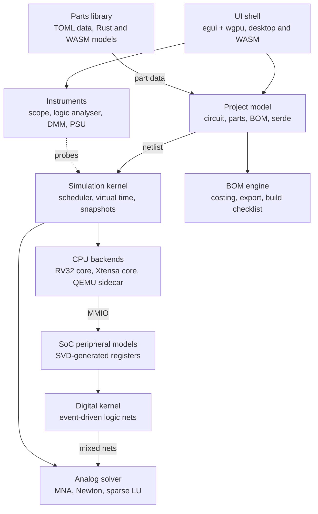

# Ohmforge: an ESP32 circuit simulator in Rust

> **Design and development plan, draft 1, 12 November 2026.**
> A researched design and phased development plan for an open-source, true-to-life ESP32 mixed-signal simulator with built-in bill-of-materials tracking. "Ohmforge" is a working name only.
>
> Online version: [ESP32 Circuit Simulator: Design & Development Plan](https://cursor.com/canvas/store-a9cbe2bd-135b-40a8-99e5-f1384f921301/f357e02f-62ec-48c3-93b2-d13aaa1852f2)

## Contents

1. [Key decisions](#1-key-decisions)
2. [What the best simulators do](#2-what-the-best-simulators-do)
3. [ESP32 emulation options](#3-esp32-emulation-options)
4. [Analog engine](#4-analog-engine)
5. [Mixed-signal co-simulation](#5-mixed-signal-co-simulation)
6. [System architecture](#6-system-architecture)
7. [Component model and library](#7-component-model-and-library)
8. [Firmware loading](#8-firmware-loading)
9. [User interface and instruments](#9-user-interface-and-instruments)
10. [Real-world realism](#10-real-world-realism)
11. [Bill of materials and build tracking](#11-bill-of-materials-and-build-tracking)
12. [Validation against real hardware](#12-validation-against-real-hardware)
13. [Open source on GitHub](#13-open-source-on-github)
14. [Roadmap and MVP](#14-roadmap-and-mvp)
15. [Risks and mitigations](#15-risks-and-mitigations)
16. [Verified Rust crate shortlist](#16-verified-rust-crate-shortlist)
17. [Sources](#17-sources)

---

## 1. Key decisions

> **The recommendation in one paragraph.** Build a deterministic Rust simulation kernel that couples a SPICE-grade sparse MNA analog solver with an event-driven digital/peripheral layer, and run unmodified ESP32 ELF firmware on our own Rust CPU cores, starting with the RISC-V ESP32-C3 (simplest ISA, runs in the browser) and using Espressif's QEMU as an out-of-process sidecar for the Xtensa ESP32/S3 until our own Xtensa core is ready. One egui/wgpu codebase ships as a native desktop app and a WASM web app. Every placed part is a real, orderable part with a manufacturer part number, so the BOM, cost and build checklist fall out of the design automatically.

| Decision | Choice |
|---|---|
| Language | Rust (2024 edition), single Cargo workspace |
| First chip | ESP32-C3 (RV32IMC) on our own core; classic ESP32 via QEMU sidecar |
| Analog solver | Own MNA engine, Newton-Raphson, faer sparse LU, trapezoidal/BDF2 with adaptive timestep |
| Time base | Global `u64` picosecond clock, deterministic and replayable |
| UI | egui + wgpu via eframe; native and WASM from one codebase |
| Plugins | Native Rust components in-tree; sandboxed WASM components for the community |
| BOM | First-class: MPN, supplier SKUs, ZAR pricing snapshots, CSV/XLSX/KiCad/JLCPCB export |
| Licence | Code MIT OR Apache-2.0; parts data and docs CC-BY-4.0; QEMU bridge kept separate under GPL-2.0 |

---

## 2. What the best simulators do

| Simulator | How it works | Strength | Gap for us |
|---|---|---|---|
| Wokwi | Proprietary in-browser MCU engines; declarative `diagram.json`; WASM custom chips | Broadest ESP32 family and peripheral coverage incl. Wi-Fi, GDB, CI runner | Digital-only pins, no real analog solving, closed core, no BOM |
| Falstad CircuitJS | MNA matrix, LU factorise once for linear circuits, re-factorise per Newton iteration for nonlinear | Instant, intuitive animated current flow | No MCU emulation, simple device models, fixed timestep, GPL-2.0 |
| SimulIDE | Real-time Qt simulator; simavr and gpsim for AVR/PIC; experimental ESP32 via QEMU with two-way sync | MCU plus circuit on one canvas, desktop speed | Simplified analog by design; ESP32 still a proof of concept |
| Proteus VSM | Commercial mixed-mode SPICE with MCU models; ESP32 through MicroPython | Mature mixed-signal and PCB flow | Expensive, Windows-only, ESP32 not native C firmware |
| LTspice / ngspice | Full SPICE: MNA, Newton-Raphson, sparse LU, LTE timestep control, vendor models | Accuracy and model ecosystem | No firmware, slow interactive loop |
| Espressif QEMU | Instruction-level emulation of ESP32, S3, C3 (and C6 for Zephyr) | Boots real ESP-IDF images, GDB, CI | No I2C, SPI, RMT, Wi-Fi, BLE, GPIO matrix; not cycle-accurate |
| Renode | Multi-node SoC simulator, deterministic virtual time, Robot tests | Excellent test automation model | Xtensa core only, no ESP32 SoC; C3 interrupt controller unsupported |
| Velxio (open source) | avr8js and rp2040js in browser; lcgamboa QEMU fork for ESP32; ngspice for analog nets | Proves the QEMU plus ngspice hybrid | Server-side QEMU, Python glue, loose timing coupling |

The gap nobody fills: real firmware, an honest analog solver and the parts you will actually buy, in one deterministic tool. Wokwi wins on MCU breadth, SPICE wins on electrical truth; Ohmforge's job is to join them with tight time synchronisation.

- **Borrow from Wokwi:** declarative text project files, a small custom-chip API, CI-friendly headless runs, GDB.
- **Borrow from Falstad:** live current animation and reuse of the LU factorisation when the matrix is unchanged.
- **Borrow from SPICE:** device physics, convergence aids and timestep control.
- **Borrow from Renode:** virtual time that never depends on wall-clock, so every run is reproducible.

---

## 3. ESP32 emulation options

| Peripheral | Espressif QEMU | Wokwi | Ohmforge target |
|---|---|---|---|
| CPU, interrupts, timers | Yes | Yes | P2 (C3), P4 (Xtensa) |
| GPIO matrix / IOMUX | No | Yes | P2, with electrical pin model |
| UART | Yes | Yes | P2 |
| ADC | No | Yes | P2, with attenuation, nonlinearity and noise |
| LEDC PWM | ESP32 only | Yes | P2 |
| I2C, SPI | No | Yes (I2C master only) | P3, bit-level on the wire |
| RMT (WS2812) | No | Yes | P3 |
| DAC (ESP32, S2) | No | Not listed | P3 |
| Wi-Fi | No (OpenCores Ethernet instead) | Yes | P4 virtual radio |
| Bluetooth LE | No | No | P6 stretch |
| Deep sleep, RTC, ULP | No ULP | Partial | P4 power modes; ULP later |

### Own Rust CPU cores vs wrapping QEMU

| Own Rust CPU cores (pros) | Wrapping QEMU (cons) |
|---|---|
| Runs in the browser and in-process, no sidecar | GPL-2.0, so must live in a separate process |
| Deterministic lockstep with the analog solver | Not available on the web target |
| Cycle-approximate timing we control | Missing the very peripherals hobbyists use (I2C, SPI, RMT) |
| Licence-clean (MIT/Apache) | Coarse time sync through IPC |
| RV32IMC is a small, well-specified ISA with conformance suites | But: fastest route to classic ESP32 coverage, and an excellent black-box reference for testing our own cores |

**Decision:** ESP32-C3 on our own core first, because RISC-V is simpler and conformance tests exist. Classic ESP32 and S3 run on a QEMU sidecar (the lcgamboa fork already builds QEMU as a library with GPIO callbacks and Wi-Fi) until our own Xtensa LX6/LX7 core lands in phase 4. Xtensa windowed registers and the zero-overhead loop are the hard parts; budget for them.

Peripheral register maps are generated from Espressif's SVD data (the esp-pacs crates are MIT/Apache), and behaviour is taken from the Technical Reference Manuals and the Apache-2.0 ESP-IDF HAL layer.

---

## 4. Analog engine

Modified Nodal Analysis: one equation per non-ground node plus one per voltage source or inductor. Each device stamps conductances into **G**, incidence into **B** and **C**, and source values into the right-hand side.

```
[ G  B ]   [ v ]   [ i ]
[ C  D ] · [ j ] = [ e ]
```

Capacitors and inductors become companion models each step. With the trapezoidal rule a capacitor is a conductance in parallel with a history current source:

```
G_eq = 2C / h,    I_eq = G_eq · v_n + i_n
```

### Transient solve loop

1. **Topology analysis.** Build the sparse pattern once; faer's symbolic LU (ordering, fill-in) is reused until the circuit is edited.
2. **DC operating point.** Newton-Raphson with junction voltage limiting, then gmin stepping, then source stepping if it fails to converge.
3. **Transient step.** Stamp companion models, iterate Newton until |Δv| and |Δi| meet reltol/abstol (SPICE defaults 1e-3, 1 µV, 1 pA).
4. **Accept or reject.** Estimate local truncation error; shrink h and retry, or accept and grow h. Trapezoidal by default, BDF2 (Gear) to damp ringing.
5. **Breakpoints.** Every digital edge, PWM transition and source corner is a breakpoint, so h lands exactly on it.
6. **Fast paths.** Linear-only circuits skip refactorisation (Falstad trick); latent sub-circuits are bypassed when nothing changes.



### Device models

| Device class | Model | Phase |
|---|---|---|
| R, C, L, coupled L, V/I sources, switches | Ideal plus ESR, ESL, tolerance, tempco | P1 |
| Diode, LED, Zener | Shockley with series R, junction cap, breakdown; LED Vf curve and light output | P1 |
| BJT | Gummel-Poon (SPICE level 1 subset) | P1 |
| MOSFET | Level 1 and 3, body diode, Rds(on) vs temperature | P1/P5 |
| Op-amps, comparators, regulators | Macromodels and `.subckt` import (AMS1117, LM358, TL431) | P3 |
| Electromechanical | DC motor with back-EMF and inertia, relay coil and contacts, servo | P3 |
| Energy | Li-ion/LiPo with state-of-charge and internal resistance, coin cell, USB 5 V source | P4 |

---

## 5. Mixed-signal co-simulation

One scheduler owns time. The CPU runs in quanta of instructions, but stops early whenever it touches an I/O register; the analog solver advances to that instant before the access completes, so firmware and circuit always see the same picosecond.



- **Pins are electrical, not boolean:** an output is a voltage source with drive-strength-dependent resistance; an input has leakage, capacitance, pull-ups and Schmitt thresholds from the datasheet (for example VIH = 0.75 × VDD).
- Nets with only digital endpoints are solved by a fast event-driven logic kernel; any net touching an analog part is promoted to the MNA solver automatically.
- Bus traffic (I2C, SPI, UART) is driven as real edges, so missing pull-ups, slow rise times and contention appear in the scope as they would on the bench.
- **Accuracy tiers** the user can choose: *Functional* (fast, transaction-level buses), *Timed* (default) and *Electrical* (every edge analog).

---

## 6. System architecture



The kernel and all models have no UI or OS dependencies and compile to `wasm32`, so the same core runs in the desktop app, in a browser Web Worker, and as a headless CLI for CI (`ohmforge run --until 5s --assert`).

### 6.1 Workspace layout

```text
ohmforge/
├─ Cargo.toml                # workspace, shared lints, MSRV
├─ crates/
│  ├─ of-core/               # time, scheduler, events, snapshot/replay
│  ├─ of-netlist/            # circuit graph, net partitioning (petgraph)
│  ├─ of-analog/             # MNA, Newton, integrators, device models (faer)
│  ├─ of-digital/            # event-driven logic kernel, 4-state values
│  ├─ of-cpu-riscv/          # RV32IMC(+A) interpreter, block cache
│  ├─ of-cpu-xtensa/         # LX6/LX7 core (phase 4)
│  ├─ of-cpu-qemu-ipc/       # MIT/Apache client for the GPL sidecar protocol
│  ├─ of-soc-esp32c3/        # C3 peripherals, memory map, ROM hooks
│  ├─ of-soc-esp32/          # classic ESP32 peripherals
│  ├─ of-firmware/           # ELF/bin/flash image loading, DWARF symbols
│  ├─ of-component-api/      # Component trait, stamps, pin API (stable)
│  ├─ of-components/         # built-in parts (resistor ... SSD1306, BME280)
│  ├─ of-plugin-wasm/        # wasmtime host for community WASM parts
│  ├─ of-instruments/        # scope, logic analyser, decoders, DMM
│  ├─ of-bom/                # BOM model, costing, CSV/XLSX/KiCad export
│  ├─ of-kicad/              # netlist and .kicad_sch writer
│  ├─ of-gdb/                # gdbstub integration
│  ├─ of-ui/                 # egui views: schematic, breadboard, panels
│  ├─ of-app/                # desktop binary (eframe)
│  ├─ of-web/                # WASM entry point (trunk)
│  └─ of-cli/                # headless runner for CI and scripting
├─ library/                  # parts data (CC-BY-4.0), one dir per part
├─ firmware-tests/           # source for test firmware, built in CI
├─ validation/               # ngspice and hardware reference traces
├─ docs/                     # mdBook site
├─ rfcs/                     # design proposals
└─ deny.toml, LICENSE-MIT, LICENSE-APACHE, NOTICE
```

---

## 7. Component model and library

A part is data plus behaviour. Data (pins, ratings, tolerances, symbols, BOM fields) lives in a TOML file anyone can edit; behaviour is a Rust or WASM model implementing one small trait.

```rust
pub trait Component: Send {
    /// Pins, internal nodes and parameters, resolved from part.toml
    fn describe(&self) -> &ComponentInfo;
    /// Linear, time-invariant stamps (called once per topology)
    fn stamp_static(&self, m: &mut StampCtx);
    /// Nonlinear or time-varying stamps (each Newton iteration)
    fn stamp_dynamic(&mut self, m: &mut StampCtx, x: &Solution, dt: Ps) {}
    /// Digital pin events, bus bytes, timers
    fn on_event(&mut self, ev: &Event, io: &mut PinIo) {}
    /// Accept a step: update state, power dissipation, junction temp
    fn commit(&mut self, x: &Solution, t: Ps) -> Health { Health::Ok }
    /// Faults the user can inject (open, short, stuck, drift)
    fn faults(&self) -> &[FaultKind] { &[] }
}
```

```toml
# library/sensors/bosch-bme280/part.toml
[part]
id = "bosch.bme280"
name = "BME280 temperature, humidity, pressure sensor"
category = "sensor/environmental"
datasheet = "https://www.bosch-sensortec.com/products/environmental-sensors/humidity-sensors-bme280/"
model = "rust:bme280"          # or "wasm:bme280.wasm" or "spice:model.lib"
verification = "datasheet"      # datasheet | bench-measured | community

[electrical]
vdd = { min = 1.71, typ = 3.3, max = 3.6, unit = "V" }
idd_active = { typ = 3.6e-6, unit = "A", note = "1 Hz humidity+temp" }
i2c_addresses = [0x76, 0x77]

[[variant]]                     # what you actually buy
label = "GY-BME280 breakout, 3.3 V"
mpn = "BME280"
manufacturer = "Bosch Sensortec"
footprint = "Module:GY-BME280"
offers = [
  { supplier = "lcsc", sku = "C92489" },
  { supplier = "mouser", sku = "262-BME280" },
]

[license]
data = "CC-BY-4.0"
artwork = "CC-BY-4.0"
```

- Built-in parts are Rust (fast, reviewed). Community parts are WASM modules in a sandbox: no file or network access, fuel-limited, deterministic.
- The WASM API mirrors Wokwi's custom chips (pins, timers, I2C, SPI, UART, attributes) and adds analog: read node voltage, set a Norton/Thevenin source, declare dissipated power.
- Every parameter carries min/typ/max and tolerance, so Monte Carlo and worst-case runs need no extra data.
- SPICE `.subckt` models can be attached to a part; vendor models with restrictive terms are referenced by URL and checksum and fetched by the user, never committed.

---

## 8. Firmware loading

1. **Accept what the toolchains produce.** ELF from ESP-IDF, Arduino-ESP32, esp-hal/esp-idf-hal (Rust), MicroPython; merged flash `.bin`; UF2.
2. **Parse and map.** `object`/`goblin` for sections, `gimli` for DWARF so the debugger and profiler show source lines and variables.
3. **Build a flash image.** Use espflash's image format logic to place bootloader, partition table and app at real offsets; eFuses from a per-chip default file.
4. **Boot like silicon.** Run the real mask ROM from Espressif's Apache-2.0 esp-rom-elfs, or a fast direct-boot path that skips the bootloader.
5. **Watch and rebuild.** Optional: watch the build directory and hot-reload the firmware while keeping the circuit state.
6. **Debug.** GDB remote protocol via the `gdbstub` crate: breakpoints, watchpoints, and pausing virtual time.

---

## 9. User interface and instruments

**Recommendation:** egui on wgpu through eframe. Immediate mode suits instruments repainting at 60 fps, it is pure Rust, and the same code targets desktop and the web. Tauri or Leptos would split the project into Rust plus a web front-end and double the UI work.

| View or instrument | What it does |
|---|---|
| Schematic | Symbol-based editor, nets, labels, live voltage colouring and animated current (Falstad-style) |
| Breadboard | True 2.54 mm geometry: catches parts that cannot physically fit, shorted rows, wire lengths and colours |
| Oscilloscope | 4+ channels, triggers, cursors, FFT (realfft), math channels |
| Logic analyser | 16+ channels, I2C/SPI/UART/WS2812/1-Wire decoders, VCD export for PulseView or GTKWave |
| Multimeter and probes | Click any net or part: V, I, power, junction temperature |
| Bench PSU and generator | Current-limited supply, function generator, battery models |
| Serial monitor and plotter | UART and USB-CDC, with input |
| Power profiler | Current over time per rail, sleep-mode breakdown, battery-life estimate |
| Debugger panel | Registers, disassembly, FreeRTOS task list, peripheral register viewer |

---

## 10. Real-world realism

| Area | Behaviour |
|---|---|
| Power | Rail-level current from datasheet figures per ESP32 mode (active with or without radio, modem, light and deep sleep); brownout detector trips when the rail sags. |
| Thermal | RC thermal network per part; regulators, LEDs and MOSFETs heat up and derate. Exceeding absolute maximums raises a damage event instead of silently continuing. |
| Tolerances | E-series values with 1 % or 5 % spread, tempco, Monte Carlo and worst-case corners; reports yield. |
| ADC truth | ESP32 attenuation ranges, nonlinearity near the rails, noise, eFuse calibration curves; Wi-Fi activity disabling ADC2 on the classic ESP32. |
| Pin rules | Strapping pins (GPIO0, 2, 5, 12, 15 on classic ESP32), flash pins GPIO6 to 11, input-only GPIO34 to 39, all flagged at wiring time. |
| Fault injection | Open or shorted parts, stuck pins, cold joints, I2C NACK or clock stretching, noisy supply, sensor out of range, Wi-Fi drop-outs, brownouts. |

---

## 11. Bill of materials and build tracking

The BOM is derived from the design, never typed by hand. Each placed instance points at a library variant with an MPN, and the breadboard view contributes the things a schematic forgets.

| BOM field | Source |
|---|---|
| Reference, value, quantity | Placed parts, grouped by variant |
| Manufacturer and MPN | Library variant |
| Supplier SKUs and links | Offers in `part.toml`; optional supplier API plugins with the user's own keys |
| Unit and extended cost (ZAR) | Dated price snapshots per supplier, with currency conversion and price breaks |
| Build extras | Breadboard, jumper wires by length, headers, USB cable, battery holder, inferred from the breadboard view |
| Substitutes | Pin- and spec-compatible alternatives when stock or price is poor |
| Do-not-fit and notes | Per instance |

- **Suppliers out of the box:** LCSC, Mouser, DigiKey, RS Components, plus South African stores such as Communica, DIYElectronics and Micro Robotics as offer entries.
- **Exports:** CSV, XLSX (`rust_xlsxwriter`), KiCad netlist and `.kicad_sch` with MPN fields so `kicad-cli` BOM export works, JLCPCB BOM/CPL, and a Markdown or PDF build sheet.
- **Generated build checklist:** parts to buy, wiring order, pre-power checks (polarity, decoupling present, level shifting for 5 V parts, GPIO current under limit, I2C pull-ups), then first-power test steps with expected readings taken from the simulation.
- **Power budget** and battery-life summary attached to every BOM, so the bill states what the build will draw.

---

## 12. Validation against real hardware

| Layer | Reference | Pass criterion |
|---|---|---|
| RISC-V core | riscv-arch-test conformance suite; lockstep trace diff against QEMU as a black box | All tests pass; zero divergence over 10⁹ instructions |
| Xtensa core | Lockstep diff against Espressif QEMU, ESP-IDF unit tests | Zero divergence on test firmware |
| Analog solver | Same netlists run in ngspice; compare waveforms | Under 1 % RMS error on the reference set |
| Peripherals | ESP-IDF test apps and examples run headless | Same pass/fail as on silicon |
| Whole system | Hardware-in-the-loop rig: DevKit + sigrok logic analyser + scope + INA226 power monitor running the same firmware | Edge timing within 2 %, ADC within 2 LSB after calibration, current within 10 % |

The rig runs on a self-hosted GitHub Actions runner; captured traces are stored in `validation/` and become regression fixtures. Every bug report tagged `accuracy` should include a bench capture.

---

## 13. Open source on GitHub

### 13.1 Licensing and compatibility

| Item | Licence | How we use it safely |
|---|---|---|
| Ohmforge code | MIT OR Apache-2.0 | Rust ecosystem norm; Apache adds a patent grant; compatible with every crate below |
| Parts data, artwork, docs | CC-BY-4.0 | Reusable, including commercially, with attribution |
| egui, wgpu, faer, nalgebra, serde, object, gimli | MIT and/or Apache-2.0 | Link freely |
| Espressif ROM ELFs | Apache-2.0 | May redistribute; ship LICENSE and NOTICE; prefer download-on-first-run |
| ESP-IDF, esp-hal, esp-pacs | Apache-2.0 / MIT | Reference and generate register maps |
| Espressif QEMU, lcgamboa fork | GPL-2.0 | Separate repo and separate process over a documented socket protocol; never linked or dlopen-ed into Ohmforge |
| Unicorn engine | GPL-2.0 | Avoid; it also lacks Xtensa |
| ngspice | BSD-3 core; numparam LGPL; table.cm GPL | Optional: loaded at runtime, used as a CI oracle; never ship table.cm; do not use the ngspice name in ours |
| SuiteSparse KLU | LGPL-2.1 | Avoid in core; faer's sparse LU instead |
| Falstad CircuitJS, SimulIDE | GPL-2.0, GPL-3.0 | Ideas only; no code copied or translated |
| Wokwi | Proprietary | Inspiration only; our plugin API is our own design |
| KiCad libraries | CC-BY-SA 4.0 with exception | Do not bundle; reference footprint names as strings only |
| Vendor SPICE models | Often no redistribution | Store URL plus checksum; user fetches |

> ⚠️ **The one rule that prevents licence conflicts.** No GPL or LGPL code is linked into any crate in the main workspace. `cargo-deny` enforces this on every pull request, and anything copyleft lives in its own repository and process. The FSF treats programs talking over pipes or sockets as separate works, which is what keeps the QEMU bridge clean.

- Contributions under the **Developer Certificate of Origin** (`Signed-off-by`), not a CLA: lower friction, and the DCO GitHub app checks it.
- **Trademarks:** describe the project as a simulator for ESP32 chips; avoid Espressif logos or names that suggest endorsement.
- Test firmware is built from source in CI rather than committed as binaries, so no blob licensing questions arise in the repo.

*This licence analysis is careful engineering guidance, not legal advice.*

### 13.2 Repository, governance and contributing

| Repository | Purpose | Licence |
|---|---|---|
| `ohmforge` | Workspace, app, CLI, docs, RFCs | MIT OR Apache-2.0 |
| `ohmforge-parts` | Community parts library (or `library/` in-tree until it grows) | CC-BY-4.0 data, MIT/Apache models |
| `ohmforge-qemu-bridge` | Patched Espressif QEMU speaking the Ohmforge sync protocol | GPL-2.0 |
| `ohmforge-hil` | Hardware rig firmware, capture scripts, reference traces | MIT OR Apache-2.0 |

- **Governance:** start as a BDFL project with Stefan as lead maintainer; `GOVERNANCE.md` describes how a contributor becomes a maintainer (sustained, reviewed contributions) and when it moves to a small core team.
- **RFC process** in `rfcs/` for anything touching the component API, file formats or the sync protocol.
- **Community files:** README with a GIF and web demo link, `CONTRIBUTING.md`, `CODE_OF_CONDUCT.md` (Contributor Covenant), `SECURITY.md`, issue and PR templates, `CODEOWNERS` per area.
- **Conventional Commits** with release-plz for changelogs and versioning; cargo-semver-checks guards the component API.
- **Monthly releases,** with a stable component API from 1.0 and a deprecation policy of one minor release.

### 13.3 CI with GitHub Actions

```yaml
# .github/workflows/ci.yml
name: ci
on: [push, pull_request]
jobs:
  check:
    runs-on: ubuntu-latest
    steps:
      - uses: actions/checkout@v4
      - uses: dtolnay/rust-toolchain@stable
        with: { components: "rustfmt, clippy" }
      - uses: Swatinem/rust-cache@v2
      - run: cargo fmt --all --check
      - run: cargo clippy --workspace --all-targets -- -D warnings
      - uses: EmbarkStudios/cargo-deny-action@v2   # licences, advisories, bans
  test:
    strategy:
      matrix: { os: [ubuntu-latest, windows-latest, macos-latest] }
    runs-on: ${{ matrix.os }}
    steps:
      - uses: actions/checkout@v4
      - uses: dtolnay/rust-toolchain@stable
      - uses: taiki-e/install-action@nextest
      - run: cargo nextest run --workspace
  wasm:
    runs-on: ubuntu-latest
    steps:
      - uses: actions/checkout@v4
      - uses: dtolnay/rust-toolchain@stable
        with: { targets: wasm32-unknown-unknown }
      - run: cargo install trunk --locked
      - run: trunk build --release crates/of-web/index.html
  validation:          # ngspice oracle and firmware runs, nightly
    if: github.event_name == 'push'
    runs-on: ubuntu-latest
    steps:
      - uses: actions/checkout@v4
      - run: sudo apt-get install -y ngspice
      - run: cargo run -p of-cli --release -- validate validation/
```

- **Releases:** cargo-dist builds signed Windows, macOS and Linux binaries and installers when a tag is pushed.
- **Web demo:** the trunk build deploys to GitHub Pages on every release.
- **Benchmarks:** criterion results tracked per commit so solver or CPU speed regressions are visible.
- **Hardware-in-the-loop** job on a self-hosted runner with the DevKit rig, nightly and on demand.

```toml
# deny.toml (excerpt)
[licenses]
allow = ["MIT", "Apache-2.0", "BSD-2-Clause", "BSD-3-Clause", "ISC",
         "Zlib", "Unicode-3.0", "MPL-2.0", "CC0-1.0"]
# GPL, LGPL and AGPL are rejected by omission
```

### 13.4 Community parts library

1. **Open a part request or pick one.** Issue template asks for datasheet, MPN and a supplier link.
2. **Copy the template.** `ohmforge new-part sensors/my-part` creates `part.toml`, `symbol.svg`, `breadboard.svg` and a test file.
3. **Describe it in TOML.** Many passives, connectors and modules need no code at all; they use generic models.
4. **Add behaviour if needed.** Rust in `of-components` for core parts, or a WASM model for anything else.
5. **Add a behaviour test.** A tiny circuit plus expected readings; bench-measured parts attach a capture.
6. **CI validates.** JSON Schema check (schemars), licence field present, previews rendered into the PR, test circuit passes.
7. **Review and merge.** Category CODEOWNERS review; verification level set to community, datasheet or bench-measured.

### 13.5 Docs, labels and attracting contributors

| Label group | Labels |
|---|---|
| Type | `bug`, `feature`, `docs`, `accuracy`, `performance`, `rfc` |
| Area | `area:analog`, `area:cpu-riscv`, `area:cpu-xtensa`, `area:peripherals`, `area:ui`, `area:bom`, `area:library`, `area:web` |
| Effort | `good first issue`, `help wanted`, `mentor available` |
| Parts | `part-request`, `part-needs-test`, `part-bench-verified` |
| Roadmap | `phase:P0` to `phase:P6`, matched to GitHub milestones and a Projects board |

- **Docs site:** mdBook on GitHub Pages with user guide, contributor guide, architecture chapters and an auto-generated parts catalogue; API docs on docs.rs.
- A **web demo** that opens a working ESP32 circuit in one click is the strongest recruiting tool; link it from the README.
- Keep the **first contribution under an hour:** adding a part is TOML-only, with good first issues always stocked.
- **Accuracy bounties:** credit and a showcase spot for bench captures that expose simulator error.
- **Fast, friendly review** (target first response within 48 hours), GitHub Discussions for questions, a showcase gallery of real builds made from Ohmforge BOMs.

---

## 14. Roadmap and MVP

| Phase | Weeks | Scope | Exit milestone |
|---|---|---|---|
| P0 Foundations | 0–6 | Workspace, scheduler, virtual time, project format, CI, licences, docs skeleton | Repo public, CI green on three OSes and WASM |
| P1 Analog core | 4–16 | MNA, DC op, transient, R/C/L/D/BJT/MOSFET, LTE timestep, CLI netlist runner | Reference set within 1 % of ngspice |
| P2 ESP32-C3 MVP | 12–28 | RV32IMC core, ROM boot, GPIO/IOMUX, UART, timers, ADC, LEDC; schematic editor; scope and logic analyser; BOM v1 | MVP release 0.1 |
| P3 Breadth | 28–42 | Classic ESP32 via QEMU sidecar; I2C, SPI, RMT, DAC; breadboard view; 50 parts; KiCad and XLSX export | 0.2: common hobby projects run |
| P4 Own Xtensa and web | 40–60 | LX6/LX7 core, web app, Wi-Fi virtual radio, sleep modes and power profiler | 0.3: classic ESP32 in the browser |
| P5 Realism | 56–72 | Monte Carlo, thermal, fault injection, hardware-in-the-loop lab, supplier price plugins | 0.4: validation report published |
| P6 1.0 | 70–84 | Stable component API and WASM SDK, ESP32-S3 and C6, docs complete, BLE stretch | 1.0 |

```mermaid
gantt
    title Ohmforge roadmap (weeks from start, estimate)
    dateFormat X
    axisFormat %s
    section Phases
    P0 Foundations         :p0, 0, 6
    P1 Analog core         :p1, 4, 16
    P2 ESP32-C3 MVP        :p2, 12, 28
    P3 Breadth             :p3, 28, 42
    P4 Own Xtensa and web  :p4, 40, 60
    P5 Realism             :p5, 56, 72
    P6 1.0                 :p6, 70, 84
```



Estimates assume two experienced Rust developers plus community help; one developer roughly doubles them. Phases overlap deliberately.

### MVP definition

1. An unmodified ESP32-C3 ELF built with Arduino-ESP32, ESP-IDF or esp-hal boots from the real ROM.
2. Blink, button with interrupt, potentiometer into the ADC and LED dimming via LEDC all behave as on a real board.
3. Analog: an RC filter, LED with series resistor, transistor switch and AMS1117 regulator match ngspice within 1 %.
4. Instruments: oscilloscope, logic analyser with UART decode, multimeter probe, serial monitor.
5. BOM: CSV export with MPNs, supplier links and ZAR cost, plus a generated build checklist.
6. Desktop builds for Windows, macOS and Linux; deterministic headless runs usable in CI.

---

## 15. Risks and mitigations

| Risk | Impact | Mitigation |
|---|---|---|
| Xtensa core effort (windowed registers, loops, dual core) | High | C3 first; QEMU sidecar bridges the gap; lockstep diff testing |
| Performance: 160–240 MHz CPU plus analog in real time | High | Analog only on mixed nets, latency bypass, block cache, later a Cranelift JIT; slow-motion mode is acceptable |
| Undocumented peripheral behaviour | Medium | TRM plus ESP-IDF HAL as reference; hardware rig to settle disputes |
| Wi-Fi emulation complexity | High | Defer to P4; begin with a virtual radio and host networking via smoltcp |
| Licence contamination | High | cargo-deny gate, separate GPL repo, clean-room policy in CONTRIBUTING |
| Convergence failures frustrate users | Medium | gmin and source stepping, clear diagnostics pointing at the offending part |
| Scope creep | Medium | MVP list is fixed; everything else goes through RFCs and phase labels |
| Single-maintainer bus factor | Medium | Docs-first culture, CODEOWNERS per area, grow a second maintainer by P3 |

---

## 16. Verified Rust crate shortlist

| Need | Crate | Version |
|---|---|---|
| UI and rendering | egui / eframe, wgpu, egui_plot | 0.37, 30.0, 0.38 |
| Sparse and dense linear algebra | faer (sparse LU with symbolic reuse), nalgebra, sprs | 0.24, 0.35, 0.11 |
| Graphs and parallelism | petgraph, rayon | 0.8, 1.12 |
| ELF, DWARF, flash images | object, goblin, gimli, espflash | 0.41, 0.10, 0.34, 4.7 |
| Debugging | gdbstub | 0.7 |
| RISC-V reference | rrs-lib (study; we write our own core) | 0.1 |
| Plugins and scripting | wasmtime, extism, rhai | 50.0, 1.41, 1.27 |
| Serialisation | serde, toml, ron, serde_json, schemars | 1.0, 1.2, 0.12, 1.0, 1.2 |
| Signals | realfft, rustfft, vcd | 3.5, 6.4, 0.7 |
| BOM export | csv, rust_xlsxwriter, typst (PDF build sheets) | 1.4, 0.102, 0.15 |
| Units | uom | 0.38 |
| KiCad | kicad-ipc-rs (live KiCad IPC API); own `.kicad_sch` writer | 0.5 |
| Hardware rig | serialport, nusb | 4.10, 0.2 |
| Tooling | cargo-deny, cargo-dist, trunk, mdbook, cargo-nextest, release-plz, criterion, proptest, insta | current |

All checked on crates.io on 12 Nov 2026. Rust SPICE crates such as sindr, thevenin and ngspice-rs exist but are very young; read them for ideas, but own the solver because it is the heart of the product. The Rust KiCad parsers on crates.io are stale (`kicad_parse_gen` last released 2018), so write a small s-expression writer.

---


## Known Issues

### Phase 0 (Pre-alpha) — Known limitations

| Issue | Severity | Status |
|---|---|---|
| Analog solver is a dense stub (not sparse LU) | High | In progress |
| No transient analysis yet (only DC operating point) | High | Starting P1 |
| CPU cores are placeholders (no real ISA implementation) | High | Planned for P2 |
| No firmware loading (ELF/DWARF) | High | Planned for P2 |
| QEMU IPC bridge not connected | High | Planned for P3 |
| No GUI instruments (scope, logic analyser) | High | Planned for P2 |
| No BOM export (CSV/XLSX/KiCad/JLCPCB) | Medium | Planned for P3 |
| No KiCad netlist export | Medium | Planned for P3 |
| No web app (WASM) | Medium | Planned for P4 |

### Technical debt

- `of-analog` uses a dense matrix solver with partial pivoting. Replaces with sparse LU (faer) once Windows toolchain is fixed.
- `of-netlist` is a stub; circuit graph is not fully implemented.
- `of-components` only has a `Resistor` stub; other components are planned.
- No part library beyond BME280; will add more sensors and components.

### Items for next phases

See the [Roadmap and MVP](#14-roadmap-and-mvp) section for the phased plan.
## 17. Sources

- [Wokwi ESP32 simulation and peripheral table](https://docs.wokwi.com/guides/esp32) (docs.wokwi.com)
- [Wokwi Custom Chips API](https://docs.wokwi.com/chips-api/getting-started) (docs.wokwi.com)
- [Espressif QEMU supported features](https://github.com/espressif/esp-toolchain-docs/blob/main/qemu/README.md) (github.com)
- [ESP-IDF QEMU guide](https://docs.espressif.com/projects/esp-idf/en/stable/esp32/api-guides/tools/qemu.html) (docs.espressif.com)
- [lcgamboa QEMU fork (library build, Wi-Fi, IOMUX)](https://github.com/lcgamboa/qemu/) (github.com)
- [Velxio emulator architecture](https://github.com/davidmonterocrespo24/velxio/blob/master/docs/emulator.md) (github.com)
- [CircuitJS internals (MNA, LU)](https://github.com/sharpie7/circuitjs1/blob/master/INTERNALS.md) (github.com)
- [SimulIDE 2.0 ESP32 tester builds](https://simulide.com/p/forum/topic/tester-builds-1-2-0/?part=4) (simulide.com)
- [Renode ESP32 status](https://github.com/renode/renode/issues/704) (github.com)
- [Proteus microprocessor simulation](https://www.labcenter.com/microprocessors/) (labcenter.com)
- [ngspice licence (COPYING)](https://github.com/ngspice/ngspice/blob/master/COPYING) (github.com)
- [ngspice shared library](https://ngspice.sourceforge.io/shared.html) (ngspice.sourceforge.io)
- [Espressif ROM ELFs (Apache-2.0)](https://github.com/espressif/esp-rom-elfs) (github.com)
- [GPL FAQ: mere aggregation](https://www.gnu.org/licenses/gpl-faq.html#MereAggregation) (gnu.org)
- [faer sparse LU](https://docs.rs/faer/latest/faer/sparse/linalg/lu/struct.SymbolicLu.html) (docs.rs)
- [KiCad schematic file format](https://dev-docs.kicad.org/en/file-formats/sexpr-schematic/) (dev-docs.kicad.org)
