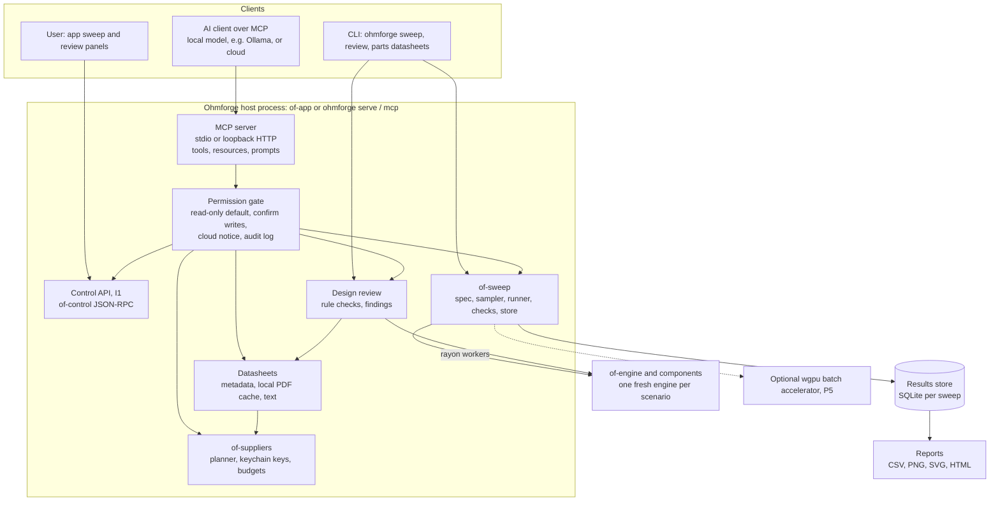

# AI link, scenario sweeps, datasheets and design review

Status: proposed (design only, no code). Nothing in this document is implemented yet; section 1 lists what exists today. Phase X0 is this document (P2). The sweep items S1 to S5, the AI items AI1 to AI5 and the datasheet items D1 to D3 are spread over P3 / 0.2 to P5 / 0.4 after the engine, control-API and parts-availability work they build on (section 9).
Date: 2026-11-23.
Related: [`compatibility-checks.md`](compatibility-checks.md) (P3 visible check panel and cited `part.toml` fields; AI4 and D2 stay the P4 batch and limits store); [`DESIGN_AND_PLAN.md`](../DESIGN_AND_PLAN.md) §5 (accuracy tiers), §7 (`part.toml`), §10 (fault injection), §13.1 (licensing); [`engine-components.md`](engine-components.md) (base engine, components, circuit files, readings and `Health`); [`editor-integration.md`](editor-integration.md) §4a (I1 control API and `ohmforge serve`); [`parts-availability.md`](parts-availability.md) (`of-suppliers`, the lookup planner, the hand-entered `bom.toml`, the `availability/` dataset); [`interconnects.md`](interconnects.md) (wire and trace sizes as sweep variables); [`buses.md`](buses.md) (bus faults as sweep variables); [`component-stress-states.md`](component-stress-states.md) (the stress levels that sweeps and reviews read); roadmap items “Monte Carlo runs over part tolerances”, “Optional GPU acceleration for batch runs” and “Fault injection” (P5).

Stefan asked for three things that share one foundation:

1. A way to link AI models to Ohmforge so they can look up current BOM details and set up and run checks.
2. Mass scenario runs: the same circuit simulated many times with changing variables (tolerances, supply, temperature, load, stimuli, firmware inputs), checked against pass/fail rules and graphed, so the operating thresholds of the design being drawn are visible.
3. A datasheet sweep for the parts in a design, and AI models that can be given those datasheets, read the schematic and advise on it or point out likely failures.

The foundation is one headless, deterministic batch runner and one local tool interface. People use it from the CLI and the app; AI models use it through the Model Context Protocol (MCP). Ohmforge never bundles a model and never links an AI vendor SDK.

## 1. Current state

What exists on `main` (23 November 2026) that this plan builds on:

| Piece | Where it lives today | What it gives this plan |
|---|---|---|
| Analyses: DC operating point (Newton with gmin and source stepping), single and nested DC sweeps (`dc_sweep`, `dc_sweep_nested`), AC, transient | `of-analog::analysis` | The per-scenario solves. Device models have SPICE3 temperature scaling; resistors take `tc1`/`tc2` |
| SPICE deck front end with `.param` expressions, `.temp`, `.dc`, `.tran`, `.options` (no `.step` or `.mc`) | `of-netlist::spice` | Temperature already reaches the models; there is no parameter-step or Monte Carlo statement |
| Toleranced parameters: `ParamSpec { min, typ, max, tol, unit, note }` and `Corner::{Typical, Min, Max, Deviation(k)}` (documented “for Monte Carlo and sweeps”) | `of-parts` | Corner and Monte Carlo values per parameter, from data already in `part.toml` |
| Ratings in `part.toml` `[electrical]` (for example `if_max` on the LEDs, `vceo` / `ic_max` on the NPN, `vdd` min/max on the ESP32-C3 and BME280) | `parts/**/part.toml`, read as free-form keys | The first limits for pass/fail checks (section 6c) |
| Datasheet field: `[part] datasheet = Option<String>` | `of-parts::PartMeta` | Set on 3 of 12 library parts: `bourns.ptv09a` and `ams1117` (PDF links) and `bosch.bme280` (a product page, not the PDF). The three 0603 LEDs name their datasheet only in a comment; the resistor, capacitors, NPN, push button and ESP32-C3 have none. No revision, date or hash is stored |
| Base engine first slice: `EngineBuilder` → `BuiltEngine` (`operating_point`, `check_kcl`), `Component` trait with `commit → Health { Ok, Warning, Damaged }`, `readings`, `FaultKind` | `of-engine`, `of-component-api` (RFC 0001) | Each scenario builds a fresh engine; `Health` and readings feed checks. Only the bench PSU returns a non-`Ok` health today |
| Headless CLI: `ohmforge run <netlist.cir>` (SPICE decks, CSV/VCD out), `validate-parts`, `bom <demo>` | `of-cli` | Grows `sweep`, `review`, `mcp` and `parts datasheets` subcommands |
| Results writers: `OpPoint`, `Sweep`, `Waveforms` with CSV and VCD | `of-analog::results` | Per-run waveform export |
| ngspice | Never linked; external tool for golden data only | Unchanged: sweeps run on the Ohmforge solver |

What does not exist: circuit files (E4), the measurement service (E5), any batch or parallel runner, seeded random sampling, a results store, plotting, the control API (I1), any MCP server, a datasheet store, a structured limits table, rule-based design checks, or any AI integration. The workspace has no `rayon`, `rand`, `rusqlite` or plotting dependency yet.

## 2. Goals and non-goals

Goals:

- **Mass scenarios.** Run thousands to hundreds of thousands of variants of one circuit headlessly, in parallel on all CPU cores, and show where it stops working: operating regions, thresholds, yield.
- **Deterministic and resumable.** The same sweep file, seed and Ohmforge version give the same results bit for bit, whatever the thread count; an interrupted sweep continues where it stopped.
- **Checks people can read.** Pass/fail rules on voltages, currents, timing, power and part ratings, written in a small TOML file next to the circuit.
- **Any model, local or cloud.** AI clients connect through MCP over stdio or local HTTP: a local model (for example through Ollama) or a cloud model, chosen by the user.
- **Safe by default.** The AI link is read-only until the user enables writes; every write is a proposal the user confirms; supplier keys never leave Ohmforge; hand entries are never overwritten; every tool call is logged.
- **Datasheets at hand.** Every part in a design has a known datasheet URL, revision and hash; the PDF is cached locally for the user and for an AI reviewer.
- **Rules first, AI on top.** Deterministic design checks run without any model; AI findings are advisory, cite the datasheet page, and are never applied automatically.

Non-goals:

- Bundling, hosting or paying for a model; linking a vendor SDK; an Ohmforge cloud service.
- Letting a model edit `part.toml`, push to Git, order parts or change files outside the project.
- Committing datasheet PDFs or supplier prices (copyright and supplier terms; see [`parts-availability.md`](parts-availability.md) §3e).
- Replacing engineering judgement. Sweeps and reviews show evidence; the user decides.
- A general optimiser that redesigns the circuit. Sweeps evaluate given variables; “suggest a value” is limited to reporting the passing range.

## 3. Architecture

**Proposed.**



- **One host, several faces.** The MCP server is a thin adapter over the same operations the control API (I1) exposes, plus sweep, review, BOM and datasheet operations. It runs inside `of-app` (the user watches what the model does) or headless as `ohmforge mcp`.
- **Crate placement.** A new crate, working name `of-sweep`, holds the sweep spec, samplers, check evaluation and the runner. Spec, sampler and check types are pure (wasm-clean); the parallel runner and the SQLite store sit behind a `host` feature. MCP, the permission gate and datasheet fetching live in host crates (`of-cli`, reused by `of-app`), next to the I1 server. Simulation crates gain no dependency on any of this.
- **Dependencies** (all permissive, checked by `cargo-deny`): `rayon` (MIT/Apache-2.0) for parallel runs; `rand_chacha` (MIT/Apache-2.0) for seeded sampling; `rusqlite` with bundled SQLite (MIT; SQLite is public domain), shared with `of-suppliers`; `plotters` (MIT) for PNG/SVG charts; `pdf-extract` or `lopdf` (MIT) for datasheet text. An MCP SDK such as the Rust `rmcp` crate is only adopted after its licence is checked; otherwise the protocol is implemented on `serde_json`, which I1 already uses for JSON-RPC 2.0.

## 4. AI link (MCP)

**Proposed.**

### 4a. Why MCP

The Model Context Protocol is an open protocol for giving models tools and context, built on JSON-RPC 2.0 with a stdio transport and a streamable HTTP transport (specification at [modelcontextprotocol.io](https://modelcontextprotocol.io)). Desktop chat apps, VS Code agents and local-model front ends (several of which run models through Ollama) can act as MCP clients. Supporting MCP means Ohmforge works with any model the user already runs, without picking a vendor, and it rides on the JSON-RPC work I1 does anyway.

### 4b. Server

- `ohmforge mcp [--project DIR] [--stdio | --listen 127.0.0.1:PORT] [--allow-writes]`; and in the app, Settings → AI link: enable, transport, write permission, connected clients.
- **Stdio** is the default (the client starts Ohmforge as a subprocess; nothing listens on a port). **Local HTTP** binds loopback only and needs the same per-session token as I1 (session file readable only by the user).
- One project per server session; a second client attaches read-only.

### 4c. Tools, resources and prompts (first set; names illustrative)

| Group | Tools | Default |
|---|---|---|
| Circuit | `circuit.read` (components, parameters, nets, the netlist), `circuit.readings` (E5 readings and stress levels), `circuit.simulate_op` (DC operating point of the current circuit or a proposed variant, not applied) | Read |
| BOM | `bom.read` (lines with offers, ages, hand-entered badges), `bom.check` (runs `ohmforge bom check` through the `of-suppliers` planner), `parts.refresh`, `parts.alternates` | Read; lookups spend the user's budgets |
| BOM edits | `bom.propose_edit` (set a hand-entered price, supplier, SKU or note; add a line; swap to an alternate) | Write: proposal only |
| Sweeps | `sweep.validate`, `sweep.propose` (write a sweep file), `sweep.run` (with a run cap), `sweep.status`, `sweep.results` (summaries, threshold tables, chart files) | Read; running needs “allow runs” |
| Datasheets | `datasheet.list`, `datasheet.text` (page-chunked text with page numbers), `limits.read`, `limits.propose` | Read; proposals are unreviewed |
| Review | `review.rules` (rule-based findings), `review.submit_findings` (the model's advisory findings) | Read; submit adds advisory findings only |
| Wires and traces | `interconnect.suggest_min_size` (smallest IEC 60228 size or trace width that meets the user's limits, from [`interconnects.md`](interconnects.md)) | Read |

Resources expose the circuit file, the BOM, the latest sweep report and the datasheet index as read-only documents. Prompts provide starting points (“check BOM availability”, “find the supply range where the LED current stays within 5 to 15 mA”, “review this design against its datasheets”).

### 4d. Permission model

- **Read-only by default.** Write tools are not even listed until the user enables writes for the session.
- **Proposals, not edits.** A write tool creates a pending change (a diff of `bom.toml`, the circuit file or a new sweep file). The app shows it; the user accepts or rejects. Headless, `ohmforge mcp --allow-writes` still writes proposals to a `proposals/` folder for review unless `--apply` was also given by the user.
- **Hand entries win.** No AI tool changes a hand-entered value in `bom.toml` or a hand-entered `part.toml` price ([`parts-availability.md`](parts-availability.md) §7 invariant 8). A model may propose a new hand entry; the old one is kept and shown beside it until the user accepts.
- **Keys stay home.** The model never sees supplier API keys or keychain entries. `bom.check` and `parts.refresh` run inside Ohmforge with the user's keys and the planner's per-provider budgets; the model sees results only. A per-session lookup cap (default: the planner's daily budget share) stops a looping model from exhausting the user's quota.
- **Run caps.** `sweep.run` takes a maximum run count and wall-time limit (defaults 10,000 runs, 10 minutes, user-configurable); larger sweeps need the user's confirmation.
- **Cloud notice.** Ohmforge cannot tell where an MCP client's model runs, so the first time a session asks for datasheet text or the full circuit, the app shows which client is asking and what will be sent, with allow once, allow for this project, or deny. An in-app model connector, if one is added later (section 7c), must show the same notice before anything goes to a non-loopback endpoint.
- **Audit log.** Every tool call (time, client name, tool, arguments without secrets, result size, accepted or rejected) goes to `ohmforge-ai.log` in the project's `.ohmforge/` folder, viewable in the app.

## 5. Scenario sweeps

**Proposed.**

### 5a. Sweep file

A sweep is a TOML file next to the circuit (`sweeps/*.sweep.toml`), CC-BY-SA-4.0 like other project data when shared.

```toml
# DRAFT: illustrative only.
[sweep]
name = "LED current over supply, temperature and tolerances"
circuit = "dimmer.circuit.toml"
analysis = { kind = "tran", stop = "20ms", step = "10us" }   # or "op", "dc"
seed = 20261123
mode = "grid"            # grid | corners | monte_carlo | worst_case | combined

[[var]]
target = "PSU1.volts"
grid = { from = 2.7, to = 3.9, steps = 25 }

[[var]]
target = "temperature"
values = [-20, 0, 25, 50, 85]   # °C, applied to every model

[[var]]
target = "R1.resistance"
tolerance = "part"       # use ParamSpec min/max/tol from part.toml
# or: dist = { kind = "normal", sigma = "tol/3" } in monte_carlo mode

[[var]]
target = "RV1.position"
grid = { from = 0.0, to = 1.0, steps = 11 }

[[var]]
target = "wire.vdd.size_mm2"     # interconnects.md
values = [0.08, 0.14, 0.25, 0.5]

[[var]]
target = "firmware.uart_rx"      # firmware input stimulus
values = ["fixtures/cmd_on.txt", "fixtures/cmd_off.txt"]

[[check]]
name = "LED current in range"
measure = "avg(i(D1.A), 1ms..20ms)"
min = 2e-3
max = 15e-3

[[check]]
name = "No part over its rating"
stress = "all"           # component-stress-states.md: fail on over-limit or damaged
level = "over_limit"

[[check]]
name = "Rail droop"
measure = "min(v(vdd))"
min = 3.0

[[output]]
plots = ["region(PSU1.volts, temperature)", "hist(avg(i(D1.A)))", "shmoo(PSU1.volts, RV1.position)"]
keep_waveforms = "failing"   # none | failing | all | sample(50)
```

### 5b. Variables

| Kind | Examples | Source of the range |
|---|---|---|
| Component values and tolerances | `R1.resistance`, `D1.vf`, `C1.esr` | Explicit values, or `tolerance = "part"` using `ParamSpec` and `Corner` from `of-parts` |
| Supply | `PSU1.volts`, `PSU1.series_r`, `PSU1.current_limit` | Explicit |
| Temperature | `temperature` (global), later per-component with the thermal model | Explicit; models already scale with temperature |
| Load | a load component's current or resistance | Explicit |
| Input stimuli | source waveforms, pot positions, button timing (seeded bounce trains already exist) | Explicit or random |
| Firmware inputs | UART RX scripts, ADC input overrides, GPIO input sequences, different firmware images | Fixture files |
| Interconnect | wire size, length, material; trace width, copper weight | [`interconnects.md`](interconnects.md) |
| Faults | opens, shorts, stuck bus lines, missing termination, noise level | `FaultKind`, [`buses.md`](buses.md) |

### 5c. Modes

- **Grid** (parameter sweep, the `.step` equivalent): the Cartesian product of all `grid`/`values` lists.
- **Corners**: every combination of min and max (and optionally typical) per toleranced variable; 2ⁿ runs, capped with a warning above a set n.
- **Monte Carlo**: N samples per grid point. Distributions aim to be as true to life as possible (decided 23 November 2026, section 12): each part kind has a default shaped by how such parts are really made and sorted, for example a tight-tolerance resistor bin selected out of a wider batch (a distribution with a gap at the centre, or bimodal) or a truncated normal for parts screened to limits. A distribution published by the manufacturer or in the datasheet is used when one exists, with its source recorded. No numbers are invented: where the real distribution is unknown, the fallback is uniform within the tolerance (conservative) and the run marks it as assumed. Users can override the distribution per part and per sweep.
- **Worst case**: a sensitivity pass (one-at-a-time ± deltas) picks the direction per variable that pushes each check towards failure, then runs those extreme combinations; reported next to Monte Carlo so the difference between statistical and absolute limits is visible.
- **Combined**: grid outside, Monte Carlo inside (for example yield at each supply voltage).

### 5d. Runner

- **One fresh engine per scenario**, built from the circuit file with overrides applied, so runs do not share state. DC-only sweeps reuse the symbolic LU factorisation per worker (the matrix structure does not change when values do).
- **Parallel and deterministic.** `rayon` across CPU cores (`--jobs N`, default all cores; the app's runner uses below-normal priority). Each run's seed is derived from the sweep seed and the run index (a counter-based ChaCha stream), never from thread order. Results are keyed by run index, so output is identical for any thread count.
- **Resumable.** Each finished run is committed to the store in a transaction; `ohmforge sweep run --resume` skips finished indices. The sweep file, circuit file, firmware and part data are hashed into the store, and resuming refuses (or warns with `--force`) if any changed.
- **Early stop and adaptive refinement** (S2): stop a Monte Carlo set when the yield confidence interval is tight enough; refine grid points near a pass/fail boundary to locate thresholds without a dense grid everywhere.
- **Cost.** Analog-only runs are fast; runs with the ESP32-C3 executing firmware run at the live simulator's speed per core (about 0.2× realtime on the busy demos today, roadmap #61), so firmware sweeps should use short windows and few variables. The report estimates total time before starting.
- **GPU** (S5): the P5 `wgpu` item can batch many small DC or transient solves of the same structure on the GPU (Stefan's Radeon, or any Vulkan/DX12/Metal adapter). It is an accelerator behind a feature flag with CPU fallback, never required, and must match CPU results within the solver tolerance.

### 5e. Results store

**Decision (proposed): SQLite**, one file per sweep (`sweeps/results/<name>-<hash>.sqlite`).

- Why SQLite: transactional per-run commits make resume safe; queries by variable, check or run index are cheap for the app's interactive plots; concurrent readers (app and CLI) work; it is already planned for `of-suppliers`, so the workspace gains no second storage stack; `rusqlite` is MIT and SQLite is public domain.
- Why not Parquet as the primary store: the `arrow`/`parquet` crates (Apache-2.0, AGPL-compatible) are a large dependency tree for a columnar format that is append-unfriendly for per-run commits. Parquet stays an optional export for people who analyse results in Python or R (feature `parquet-export`).
- Layout: `sweep` (spec, hashes, seed, version), `run` (index, variable values, status, wall time), `measure` (run, name, value), `check` (run, name, pass, margin), `stress` (run, ref, peak level), and `waveform` (run, compressed samples) for runs selected by `keep_waveforms`. A sweep of 100,000 runs with 50 scalars is about 5 million rows, a few hundred MB at most without waveforms.

### 5f. Checks

- **Measures** on any reading: `v(net)`, `i(ref.pin)`, `p(ref)`, with reducers `min`, `max`, `avg`, `rms`, `pp`, `at(t)`, over a time window; timing measures from the E5 service: `freq`, `duty`, `delay(edge a, edge b)`, `rise(10%..90%)`; firmware measures: UART text matched, GPIO edge counts.
- **Bounds**: `min`, `max`, or both; the margin (how far inside or outside the bound) is stored, not only pass/fail, so plots can shade near-misses.
- **Ratings** from the per-part limits table (section 6c) and the stress service ([`component-stress-states.md`](component-stress-states.md)): fail when any part reaches `over_limit` (or `warning`, configurable).
- **Solver health**: a run that does not converge is a distinct status (`error`), never a silent pass.

### 5g. Reports and graphs

| Plot | What it shows |
|---|---|
| Operating region (2-D pass/fail map) | Which combinations of two variables pass, with the boundary drawn; the main “where does it stop working” view |
| Shmoo plot | Pass/fail grid of two variables in the classic chip-test layout (for example supply against clock or baud) |
| Threshold curve | For one variable, the value where a check starts failing, plotted against a second variable |
| Histogram with limits | Distribution of a measure from Monte Carlo, with the check bounds and a yield figure |
| Sensitivity (tornado) | Which variable moves a measure most |
| Margin heat map | How close each run came to each check |
| Overlaid waveforms | Kept waveforms of passing and failing runs |

- `ohmforge sweep report <results> [--html out/] [--csv] [--png] [--svg]` writes a self-contained HTML report (inline SVG charts, no scripts loaded from the network), CSV tables and per-chart PNG/SVG files.
- **In-app sweep panel** (S2): edit variables and checks in a form (writes the same TOML), run with progress, cancel, resume; interactive region and histogram plots; click a point to open that scenario in the live simulator with its overrides applied.

## 6. Datasheets

**Proposed.**

### 6a. Datasheet sweep

- `ohmforge parts datasheets refresh [parts/… | --project P] [--offline]` walks every part in the library or a design and finds the manufacturer datasheet:
  1. `[part] datasheet` in `part.toml` if set (today 3 of 12 parts);
  2. URLs returned by supplier APIs through `of-suppliers` (DigiKey, Mouser and LCSC product records carry a datasheet link; Nexar, element14 and TME do too, A4);
  3. a manufacturer product page entered by a maintainer.
- For each document it records: URL, the final URL after redirects, title, manufacturer revision and date where the PDF states them, SHA-256 of the file, size, `fetched_at`, and the source of the URL.
- **New revisions**: a later refresh compares `ETag`/`Last-Modified` and then the hash; a changed hash with a new revision string is a new revision, kept side by side; dependent limits (6c) are flagged for re-review.
- **Where it lives**: the metadata (URL, revision, date, hash, source) is a shareable fact and goes in the `availability/` dataset ([`parts-availability.md`](parts-availability.md) §3e), CC-BY-SA-4.0, through reviewed PRs (the A5 scheduled job can refresh it). The PDFs are the manufacturers' copyright: cached per user in the platform data directory (`%LOCALAPPDATA%\Ohmforge\datasheets\<sha256>.pdf` on Windows), never committed, never redistributed.
- Fetching follows the same rules as supplier lookups: official links, polite rate limits, no scraping where terms forbid it, offline mode from the cache.

### 6b. Text extraction

- PDF text is extracted page by page with an MIT-licensed crate (`pdf-extract` on top of `lopdf`), stored next to the cached PDF as page-numbered chunks. If the user has poppler's `pdftotext` installed, it can be used as an external tool for better table layout (run as a process, never linked, like ngspice).
- Scanned datasheets without a text layer are flagged; OCR is not planned.

### 6c. Limits table

Datasheet limits become structured data the simulator uses, extending today's `[electrical]` keys:

```toml
# DRAFT: illustrative only, in part.toml (CC-BY-SA-4.0; numbers are facts, cited by page).
[[limit]]
key = "if"               # forward current
kind = "abs_max"         # abs_max | recommended | typical
max = 30e-3
unit = "A"
conditions = "Ta = 25 °C"
derate = { from_c = 25, slope = -0.4e-3, unit = "A/K" }   # optional
source = { doc_sha256 = "…", revision = "V.12B", page = 3 }
review = "reviewed"      # reviewed | unreviewed
```

- Keys cover supply (`vcc` / `vdd`), input thresholds (`vih`, `vil`), output current per pin and per package, power dissipation, junction and operating temperature, reverse voltage, and interface limits (`i2c_fscl_max`, `spi_sclk_max`, bus capacitance).
- **Human review gate.** Only `review = "reviewed"` limits drive pass/fail checks and stress colours by default. Values extracted by a tool or a model enter as `unreviewed` with a page reference and are shown as such until a maintainer confirms them in a PR.
- The validator (`validate-parts`) checks units, page references and that every `source` hash exists in the datasheet index.

## 7. Design review

The user-facing check panel, the first P3 rule slice, and the requirement that every rating a check uses is cited, are specified in [`compatibility-checks.md`](compatibility-checks.md). This section remains the home of the full P4 `ohmforge review` rule set and the optional AI advisory review.


**Proposed.**

### 7a. Rule-based checks first (no AI)

`ohmforge review <circuit> [--format text|json|sarif]` and the app's **Design review** panel run deterministic rules on the circuit, the operating point and (if present) the latest sweep:

| Rule | Example |
|---|---|
| ERC: unconnected inputs, floating nets, outputs shorted together | A GPIO input with nothing on it |
| Missing pull-ups | I2C SDA/SCL with no pull-up ([`buses.md`](buses.md)) |
| Unterminated CAN | A CAN bus without 120 Ω at both ends |
| Overvoltage on 3.3 V GPIO | A 5 V signal into an ESP32-C3 pin |
| Missing decoupling | An IC supply pin with no capacitor nearby (by net and schematic distance) |
| LED without a series resistor | An LED straight across a supply or GPIO |
| Ratings exceeded | Any part at `over_limit` at the operating point or in a sweep |
| Wire or trace undersized | Current above the chosen conductor rating ([`interconnects.md`](interconnects.md)) |

Each finding has an id, severity (`error`, `warning`, `info`), affected references and nets, the claim, the evidence (values), a datasheet citation where a limit was used, and a suggested fix. SARIF output lets CI and VS Code show findings next to the circuit file.

### 7b. AI advisory review

- Through MCP the model reads the circuit, BOM, operating point, stress levels, sweep summaries and page-chunked datasheet text, and returns findings with `review.submit_findings` in the same schema, marked `source = "ai:<client>/<model>"` and `advisory`.
- A finding must cite a datasheet page or a simulation value; findings without evidence are shown greyed as “unsupported”.
- Findings are advice. Accepting one opens the normal edit or proposal path; nothing is applied automatically.

### 7c. Choosing the model

- External MCP clients bring their own model (any vendor or local).
- **MCP only for now** (decided 23 November 2026, section 12). The app does not call models itself. A generic in-app connector (plain HTTP to an OpenAI-compatible endpoint such as a local Ollama, no vendor SDK, loopback default, key in the OS keychain) stays a possible later addition and would need its own decision.
- Before any content goes to a non-loopback endpoint, the app shows what will be sent (schematic, BOM, datasheet pages) and to which host, and asks once per project.

## 8. Data model (sketch)

```rust
// DRAFT: illustrative only, not a committed API.
pub struct SweepSpec {
    pub name: String,
    pub circuit: PathBuf,
    pub analysis: AnalysisSpec,           // Op | Dc { .. } | Tran { stop, step }
    pub seed: u64,
    pub mode: SweepMode,                  // Grid | Corners | MonteCarlo { n } | WorstCase | Combined { n }
    pub vars: Vec<VarSpec>,
    pub checks: Vec<CheckSpec>,
    pub output: OutputSpec,
}

pub struct VarSpec {
    pub target: Target,                   // Param { ref_, key } | Temperature | Stimulus { .. } | Fault { .. } | Interconnect { .. }
    pub values: ValueSource,              // List(Vec<Value>) | Grid { from, to, steps, log } | PartTolerance | Dist(Distribution)
}

pub enum CheckSpec {
    Bound { name: String, measure: Measure, min: Option<f64>, max: Option<f64> },
    Stress { name: String, refs: RefFilter, fail_at: StressLevel },
}

pub struct RunResult {
    pub index: u64,
    pub values: Vec<(VarId, Value)>,
    pub status: RunStatus,                // Pass | Fail | Error(String)
    pub measures: Vec<(MeasureId, f64)>,
    pub checks: Vec<(CheckId, bool, f64)>, // pass, margin
}

pub struct Finding {
    pub id: String,                       // rule id or "ai"
    pub severity: Severity,
    pub refs: Vec<String>,
    pub nets: Vec<String>,
    pub claim: String,
    pub evidence: Vec<Evidence>,          // Value { .. } | Datasheet { sha256, page }
    pub fix: Option<String>,
    pub source: FindingSource,            // Rule | Ai { client, model }
}

pub struct DatasheetRef {
    pub part_id: String,
    pub url: String,
    pub revision: Option<String>,
    pub date: Option<String>,
    pub sha256: Option<[u8; 32]>,
    pub fetched_at: Timestamp,
    pub source: Source,                   // part.toml | provider | maintainer
}
```

## 9. Phasing

Small PRs with tests. P3 already carries E4 to E6, I1 to I4 and A1 to A3; the items placed there are the ones the rest depend on.

| Item | Phase | Work | Depends on | Acceptance criteria |
|---|---|---|---|---|
| **X0** Design | P2 (now) | This document; roadmap, README, mdBook and changelog pointers. | — | Reviewed and merged by Stefan. No code change. |
| **S1** Sweep spec, runner and checks | P3 | `of-sweep`: TOML spec, grid and corner modes, `ParamSpec`/`Corner` integration, temperature, measures and bound checks, `rayon` runner with per-run seeds, SQLite store with resume, `ohmforge sweep run` and CSV export. | E4 (#48) circuit files; E5 (#49) measures (DC-only measures before it) | A 25 × 5 grid over the dimmer's supply and temperature with LED-current checks gives identical CSV output with `--jobs 1` and `--jobs 8`; killing and resuming gives the same result as one run; corners of R1 and D1 from `part.toml` give 4 runs; a non-converging run is reported as `error`; wasm32 check of simulation crates unchanged. |
| **S2** Reports, graphs and sweep panel | P4 | Region, shmoo, threshold, histogram, tornado and margin plots (`plotters`); `ohmforge sweep report` HTML/PNG/SVG; adaptive boundary refinement; in-app sweep panel with “open this scenario”. | S1; the app editor (P3) | Golden SVGs for each plot type from a fixed results file; the HTML report opens offline with no network requests; clicking a failing point opens the live simulator with that run's values. |
| **S3** Monte Carlo and worst case | P5 (replaces “Monte Carlo runs over part tolerances”) | Distributions, Monte Carlo and combined modes, yield with confidence interval and early stop, worst-case sensitivity search. | S1, S2 | Monte Carlo of a 1 % resistor divider matches the analytic σ within 5 % at 10,000 runs; the same seed gives identical samples on Windows and Linux; worst case bounds every Monte Carlo sample. |
| **S4** Firmware, stimulus and fault sweeps | P5 (with “Fault injection”) | Firmware inputs and images as variables; stimulus and fault variables (`FaultKind`, bus faults, interconnect values). | S1; B-series and W-series items; P5 fault injection | A sweep over UART RX scripts and supply voltage on the esp-hal firmware records the brown-out threshold where the banner stops appearing; a stuck-SDA fault fails the I2C read check. |
| **S5** GPU batch accelerator | P5 (the existing GPU item) | `wgpu` batched solves for same-structure DC and transient runs behind a feature flag. | S1 | Results match the CPU runner within the solver tolerance on the S1 fixture; falls back to CPU without an adapter. |
| **AI1** MCP server, read-only | P3 | `ohmforge mcp` over stdio and loopback HTTP; circuit, readings, BOM and cached availability tools and resources; audit log; token for HTTP. | I1; E4; A1 | An MCP client lists tools, reads the dimmer circuit and BOM, and runs `circuit.simulate_op` on a variant without changing the project; write tools are absent; every call appears in the audit log; HTTP without the token is refused. |
| **AI2** BOM tools and proposals | P3 | `bom.check`, `parts.refresh`, `parts.alternates` through the `of-suppliers` planner and budgets; `bom.propose_edit` with in-app confirm and the headless `proposals/` folder; per-session lookup cap. | AI1; A2 | A model-driven refresh stays within the session cap; a proposed price for R1 appears as a pending change and is applied only after confirmation; a proposal never replaces an existing hand entry; a sentinel supplier key never appears in tool results or logs. |
| **AI3** Sweep tools | P4 | `sweep.validate/propose/run/status/results`, run caps, chart files as resources. | AI1; S1, S2 | A model writes a sweep file for “supply range where the LED current is 5 to 15 mA”, runs it within the cap and returns the threshold values that match the CLI report. |
| **D1** Datasheet sweep | P3 | Datasheet metadata in `availability/`, provider-returned URLs, local PDF cache with hashes, revision detection, `ohmforge parts datasheets refresh`; fill in `datasheet` for the 9 library parts that lack it. | A1; A2 for provider URLs | Every library part has a datasheet entry with URL, hash and `fetched_at`; a changed fixture PDF is detected as a new revision; no PDF is tracked by Git (CI check). |
| **D2** Limits table | P4 | `[[limit]]` schema, validator, reviewed limits for the library parts; stress service and sweep rating checks read it. | D1; E6 (#50); V1 | The LEDs', NPN's, AMS1117's and ESP32-C3's limits are reviewed with page references; an unreviewed limit does not fail a check unless enabled. |
| **D3** Text extraction and limit proposals | P4 | Page-chunked text, `datasheet.text` and `limits.propose` tools; proposals land as `unreviewed` with page references. | D1, D2; AI1 | Text for the AMS1117 datasheet is returned with page numbers; a proposed limit appears unreviewed with its page and does not change check results. |
| **AI4** Rule-based design review | P4 | `ohmforge review` (text, JSON, SARIF) and the Design review panel; the rules in section 7a. | E6; V1; B2 for bus rules; W1 for conductor rules | Fixture circuits trigger each rule exactly once (missing pull-up, unterminated CAN, 5 V into a GPIO, missing decoupling, LED without resistor, rating exceeded); the demo boards pass cleanly; SARIF validates against the schema. |
| **AI5** AI advisory review | P4 | `review.submit_findings` over MCP; evidence requirement; the cloud notice for MCP sessions. | AI4; D3 | With a local Ollama model, a review of a fixture with a 3.3 V part on 5 V returns at least one cited advisory finding; nothing is sent to a non-loopback endpoint without the notice being accepted; findings are never applied without the user. |

## 10. Invariants

1. **No model bundled, no vendor SDK linked.** MCP only for now; the user chooses the model in their MCP client.
2. **Read-only by default; writes are proposals** confirmed by the user, and every AI action is in the audit log.
3. **Keys never leave Ohmforge.** Supplier keys stay in the keychain; models see results only, within budgets and caps.
4. **Hand entries are never overwritten** by any AI tool, refresh or sweep.
5. **Deterministic sweeps.** Same spec, inputs, seed and version give the same stored results for any thread count.
6. **Simulation crates stay clean.** Runners, stores, MCP and HTTP live in host crates; the wasm32 check keeps passing.
7. **No copyrighted documents committed.** Datasheet PDFs and extracted text stay in the user's cache; only metadata and cited numeric limits are committed.
8. **Rules first, AI advisory.** Rule-based findings never depend on a model; AI findings carry their source and evidence and are never auto-applied.
9. **ngspice never linked**; sweeps run on the Ohmforge solver.

## 11. Risks

| Risk | Impact | Mitigation |
|---|---|---|
| Firmware-in-the-loop runs are slow (about 0.2× realtime per core today) | Large firmware sweeps take hours | Analog-only and DC sweeps by default; short windows; time estimate before running; S5 for analog batches; speed work on the roadmap |
| Combinatorial explosion | A grid of 6 variables × 20 steps is 64 million runs | Show the run count before starting; caps; Monte Carlo and adaptive refinement instead of dense grids |
| A model loops or misuses tools | Exhausted supplier budgets, long CPU use | Session caps on lookups and runs; read-only default; audit log; the user can disconnect a client |
| Prompt injection through datasheet text or supplier data | A model is steered to propose harmful edits | Models can only propose; proposals show their source; no tool reaches outside the project |
| Wrong AI-extracted limits | False passes or failures | Unreviewed limits do not drive checks by default; page references; maintainer review |
| Datasheet copyright and site terms | PDFs cannot be shared | Metadata only in the dataset; per-user cache; official links |
| Privacy when a cloud model is used | Unreleased designs leave the machine | Explicit notice per project; loopback default; nothing preconfigured to a cloud service |
| MCP evolves | Clients break | Track the published spec version; keep the adapter thin over I1 |

## 12. Decided and open questions

Decided (23 November 2026, Stefan):

- **SQLite** is the results store; Parquet is an optional export.
- **MCP** is the AI interface, over stdio by default and loopback HTTP with a token; no model or vendor SDK bundled.
- **Monte Carlo moves into the sweep plan** as S3 and replaces the P5 “Monte Carlo runs over part tolerances” item; the GPU item becomes S5.
- **Datasheet metadata** goes in the `availability/` dataset; PDFs stay in each user's cache.
- **Limits location** (former open question 1). `[[limit]]` tables in `part.toml`, next to `[electrical]`.
- **Sweep file home** (former open question 2). A `sweeps/` folder next to the circuit.
- **Monte Carlo distributions** (former open question 3). As true to life as possible: per-part-kind defaults based on real manufacturing (binned tight-tolerance parts with a centre gap or bimodal shape, truncated normal for screened parts), manufacturer- or datasheet-published distributions when available, sources recorded and no invented numbers; uniform within tolerance as the conservative fallback, marked as assumed; configurable per part and per sweep (section 5c).
- **First MCP client to document** (former open question 4). VS Code's agent mode.
- **In-app connector** (former open question 5). MCP only for now; no in-app model connector (section 7c).
- **Limits review** (former open question 6). Stefan's PR review is enough to mark a limit `reviewed`. A future option is user or community review of limits, where users confirm or flag a value with a datasheet page reference.

Open questions: none at present.
