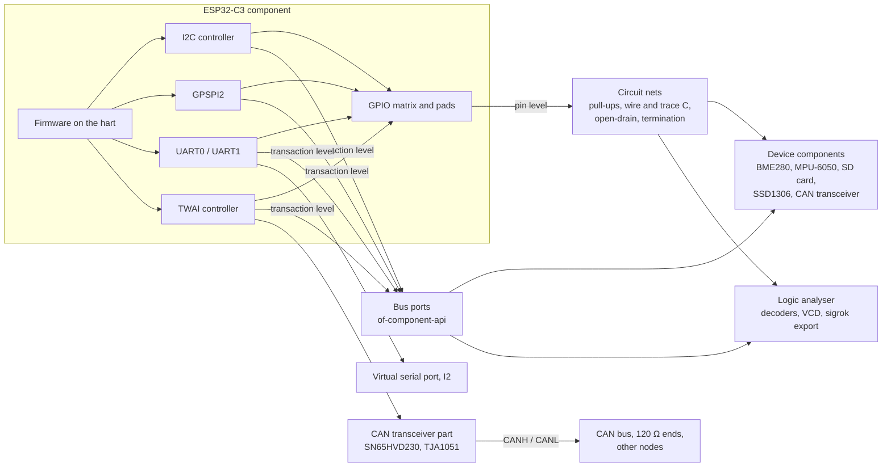

# Buses: I2C, SPI, UART and CAN (TWAI)

Status: proposed (design only, no code). Nothing in this document is implemented yet except the UART0 pieces listed in section 1. Phase B0 is this document (P2). B1 to B5 are planned in P3 / 0.2 as the design of the existing P3 “Peripherals: I2C, SPI, RMT, DAC” item, extended with full UART and protocol decoders; B6 (TWAI/CAN) is in P4 / 0.3 and B7 (bus faults) in P5 / 0.4 (section 8).
Date: 2026-11-23.
Related: [`DESIGN_AND_PLAN.md`](../DESIGN_AND_PLAN.md) §5 (bus traffic as real edges; accuracy tiers Functional, Timed and Electrical), §9 (logic analyser with decoders and VCD export), §10 (fault injection: I2C NACK, clock stretching); [`engine-components.md`](engine-components.md) §3b (component API, active components), §3c (UART0 as a port; “future I2C/SPI/RMT become ports of the same kind”), §3f (instruments); [`rfcs/0001-component-api.md`](../../rfcs/0001-component-api.md); [`editor-integration.md`](editor-integration.md) §4b (I2 virtual serial port); [`interconnects.md`](interconnects.md) (line capacitance and length); [`ai-and-scenario-sweeps.md`](ai-and-scenario-sweeps.md) (bus faults as sweep variables, design-review rules); [`component-stress-states.md`](component-stress-states.md); UX decision d4 ([`UX-Research/decisions/logic-decode.md`](../UX-Research/decisions/logic-decode.md)); [`COMPONENTS.md`](../COMPONENTS.md) (parts blocked on I2C, SPI and TWAI).

Stefan asked for I2C, SPI, UART and CAN bus simulation. Most of this is already planned in outline: the P3 peripherals item names I2C and SPI, `DESIGN_AND_PLAN.md` asks for real edges and three accuracy tiers, d4 asks for protocol decode panels, and `COMPONENTS.md` lists the parts waiting on each bus. What was missing is a design that ties them together, the rest of UART, and CAN at all (the ESP32 calls its CAN controller TWAI, “two-wire automotive interface”; it is not on the P3 list). This note is that design. It cross-references the existing items rather than duplicating them.

## 1. Current state

| Piece | Where it lives today | Status |
|---|---|---|
| UART0 | `of-soc-esp32c3::uart` | TX bytes are captured instantly (the TX FIFO never fills); RX is baud-timed, one frame at a time with start, data, optional parity and stop bits (#30), 128-byte RX FIFO, `RXFIFO_FULL`/`TOUT`/`OVF` interrupts; config registers hold values and `baud()` derives the rate. No pin-level TX waveform, no framing or parity error detection, no RTS/CTS flow control, no UART1 |
| UART port | `of-soc-esp32c3::component` (`UART0_PORT = "uart0"`, `Esp32c3Component::uart0_port`) | A named port a serial console instrument can attach to (E3) |
| Serial monitor | `of-instruments::serial`, `of-ui` | TX log, Send into RX at the configured baud, hex view, find |
| USB Serial/JTAG | `of-soc-esp32c3::usb_serial` | TX capture only |
| SPI | `of-soc-esp32c3::spi_mem`, `flash` | SPI0/SPI1 flash controllers and a 4 MiB NOR chip for booting. **No general-purpose SPI (GPSPI2)** |
| I2C, TWAI, RMT | — | Not modelled; no register blocks (`COMPONENTS.md` “Not modelled on the C3”) |
| Digital kernel | `of-digital` | Placeholder with a 4-state `Logic` type (`Low`, `High`, `HighZ`, `Unknown`); no scheduler yet |
| Bus devices | `parts/sensors/bosch-bme280` | `part.toml` has `i2c_addresses = [0x76, 0x77]` and `model = "rust:bme280"`, but only the supply load is simulated |
| Logic analyser | Roadmap P2 “logic analyser with UART decode” (not done); d4 (decode panels for I²C, SPI, UART, 1-Wire, WS2812; VCD export) | Planned |
| Plans | ROADMAP P3 “Peripherals: I2C, SPI, RMT, DAC (C3 and classic ESP32)”; `DESIGN_AND_PLAN.md` §5 accuracy tiers, §10 fault injection | TWAI/CAN not planned anywhere; `COMPONENTS.md` notes the CAN transceiver is blocked on it |

## 2. Goals and non-goals

Goals:

- ESP32-C3 peripheral models good enough for unmodified ESP-IDF, Arduino-ESP32 and esp-hal drivers: I2C controller (master, then slave), GPSPI2 (master, then slave), UART0 and UART1 (baud, data bits, parity, stop bits, RTS/CTS and software flow control, errors), and TWAI (CAN 2.0A/B). The classic ESP32 and the S3 follow with those SoCs.
- **Two fidelity levels, chosen per bus** (mapping to the `DESIGN_AND_PLAN.md` tiers):
  - **Transaction level** (Functional): bytes and transactions are exchanged between the controller and device models at the right virtual times, without solving every edge. Fast, for firmware development.
  - **Pin level** (Timed and Electrical): the controller drives pads, devices sample nets, and every edge goes through the circuit, so pull-up values, bus capacitance, open-drain behaviour, mismatched baud rates and missing termination cause the same failures they cause on the bench.
- Device models on the bus as ordinary components through the RFC 0001 component API.
- A logic analyser with protocol decoders and export.
- Faults that the scenario-sweep plan can vary.

Non-goals:

- CAN FD (the C3's TWAI is classic CAN 2.0 only), LIN, I3C, QSPI/OPI displays and PSRAM in this plan.
- Certified protocol conformance testing.
- Modelling every device on the market; the library grows one part at a time through `COMPONENTS.md`.

## 3. Architecture

- **Bus ports.** The component API gains typed bus ports (`I2cPort`, `SpiPort`, `UartPort`, `CanPort`) next to pins, as `engine-components.md` §3c anticipates. At transaction level the engine connects a controller port to the device ports on the same bus and passes transactions as timed events; at pin level the same devices see only their pins.
- **Same device model for both levels.** A device implements a protocol state machine once (for example the BME280 register map). At transaction level it receives decoded transactions; at pin level a shared bit-level front end (an I2C slave PHY, an SPI shift register, a UART receiver, a CAN bit-timing unit) samples its pins and feeds the same state machine. This keeps the two levels consistent and testable against each other.
- **Choosing the level.** Per bus in the circuit file (`level = "transaction" | "pin"`), defaulting to transaction level for speed; the app's accuracy-tier setting can switch all buses. Electrical checks (rise time, termination) only run at pin level; at transaction level the design review still flags missing pull-ups and termination statically.

## 4. Per bus

### 4a. I2C

- **Controller**: the C3's single I2C controller, master and slave modes, standard (100 kHz), fast (400 kHz) and fast-plus (1 MHz) rates set by firmware, command-list operation as the TRM describes, clock stretching, arbitration loss, timeouts, NACK and the matching interrupts.
- **Electrical (pin level)**: SDA and SCL are open-drain: pads pull low or release; pull-up resistors (external, or the C3's weak internal pull-ups) and the bus capacitance set the rise time. The NXP I2C-bus specification (UM10204, freely downloadable from NXP) gives the limits checked: rise time at most 1000 ns (standard mode), 300 ns (fast mode) and 120 ns (fast-mode plus), and bus capacitance at most 400 pF (550 pF for fast-mode plus); the minimum pull-up follows from the 3 mA (20 mA for fast-mode plus) sink current at V_OL. The design review warns when the pull-up and capacitance give a rise time outside the limit for the configured rate. Bus capacitance comes from pin capacitance in the limits table plus wire and trace capacitance from [`interconnects.md`](interconnects.md) W4.
- **Device behaviour**: address match and NACK on an absent address, register auto-increment, clock stretching by slow devices, repeated start.
- **Devices first**: BME280 (in the library; I2C behaviour to add), MPU-6050 on a GY-521 breakout (Stefan's module; new part with accelerometer and gyro values scriptable from a stimulus file), SSD1306 OLED, PCF8574 backpack for HD44780, INA219, ADS1115, MCP4725 (all in `COMPONENTS.md`).

### 4b. SPI

- **Controller**: GPSPI2 master (modes 0 to 3 from CPOL/CPHA, MSB/LSB first, CS setup and hold, full and half duplex, DMA as the drivers use it), then slave mode. SPI0/SPI1 stay the flash path.
- **Electrical**: push-pull edges through the circuit; the maximum usable clock is limited by line capacitance and drive strength (rise time against half the clock period) and by the device's limit in the limits table; long jumpers show up as sampling errors at pin level.
- **Devices first**: SD card in SPI mode (an image file on the host as the card contents), ST7735 and ILI9341 TFTs (frame buffer shown as a live view), SSD1306 SPI variant, 74HC595 and 74HC165.

### 4c. UART

- **Complete UART0 and add UART1**: TX timed at the baud rate (TX FIFO drains one frame at a time, `TXFIFO_EMPTY` honest), data bits 5 to 8, parity none/even/odd, 1/1.5/2 stop bits, break, RTS/CTS hardware flow control and XON/XOFF, RS-485 half-duplex direction control as the TRM describes.
- **Errors at pin level**: the receiver samples the RX net at its own baud, so a baud mismatch beyond the tolerance produces framing and parity errors and garbage bytes exactly as on hardware; the matching interrupts fire.
- **Virtual serial port**: UART0 (and UART1 on request) is what the I2 virtual serial port ([`editor-integration.md`](editor-integration.md) §4b) exposes; the port's baud and line settings come from the model, and DTR/RTS reach the auto-reset circuit.
- **Devices**: a second MCU, GPS modules (NMEA from a script), MAX485 (RS-485, `COMPONENTS.md`), USB-serial bridges as level-only parts.

### 4d. CAN (TWAI)

- **Controller**: the C3's TWAI (SJA1000-like, CAN 2.0A and 2.0B): bit timing (BRP, TSEG1, TSEG2, SJW, sample point, triple sampling), acceptance filters, arbitration on identifier, ACK, error frames, TEC/REC error counters, error-passive and bus-off, listen-only and self-test modes. The Bosch CAN 2.0 specification (freely available) is the protocol reference; ISO 11898-1 and -2 (paid) are cited, not copied.
- **Transceiver part (required)**: the controller's TX/RX pins need a transceiver; a new part models it, with SN65HVD230 (3.3 V supply, suits the C3 directly) and TJA1051 (5 V supply; the TJA1051T/3 variant has a VIO pin for 3.3 V logic) as first variants. The analog model drives CANH/CANL dominant (about 2 V differential) or recessive (both near 2.5 V, about 0 V differential), with a differential receiver threshold, slope and loop delay.
- **Bus**: CANH/CANL as a differential pair through the circuit; 120 Ω termination at each end (the design review flags missing or extra termination); stubs and cable length through [`interconnects.md`](interconnects.md); arbitration emerges from wired-AND of dominant bits across nodes.
- **Multi-node**: other nodes are a second (and third) ESP32-C3 component running its own firmware (each a separate active component in the same kernel), or a scripted CAN node component that sends and answers frames from a file. Multi-chip sessions are the same capability the editor plan's open question 4 and the P4 Wi-Fi radio need.

## 5. Logic analyser and decoders

- Extends the P2 “logic analyser with UART decode” item and d4: channels on any nets (pin level) or bus ports (transaction level, shown as synthesised edges marked as such), decoders for UART, I2C, SPI and CAN (frames, ACK, errors, stuff bits), with search and cursors.
- **Export**: VCD (already written by `of-analog::results`) for GTKWave and PulseView, and sigrok session files (`.sr`, a zip of metadata and logic data) so PulseView opens captures with its own decoders. Decoded tables export as CSV.
- Instrument placement follows E5 (instruments as components).

## 6. Faults and sweeps

Faults per bus, as `FaultKind` extensions and sweep variables ([`ai-and-scenario-sweeps.md`](ai-and-scenario-sweeps.md) §5b): stuck-low or stuck-high lines, open lines, missing or wrong pull-ups, extra capacitance, noise injected on a line, baud offset, missing or doubled CAN termination, a node that never ACKs, an I2C device that stretches the clock too long or NACKs. A sweep can find, for example, the pull-up range where an I2C bus at 400 kHz meets the rise-time limit for a given wire length.

## 7. Invariants

1. **One protocol model per device** for both fidelity levels; tests run each device at both levels and compare decoded traffic.
2. **Firmware sees hardware behaviour.** Register-level models follow the ESP32-C3 TRM; unmodified drivers are the test (esp-hal and ESP-IDF examples).
3. **Electrical failures only at pin level**, and the level in use is always visible in the UI and in reports.
4. **Deterministic**: bus events are timed in virtual time; replay gives the same traffic.
5. **Simulation crates stay wasm-clean**; decoders live in `of-instruments`.

## 8. Phasing

| Item | Phase | Work | Depends on | Acceptance criteria |
|---|---|---|---|---|
| **B0** Design | P2 (now) | This document; roadmap, README, mdBook and changelog pointers. | — | Reviewed and merged by Stefan. No code change. |
| **B1** Bus ports and device framework | P3 | Typed bus ports in `of-component-api` (amending RFC 0001 or a follow-up RFC); transaction-level routing in `of-engine`; shared bit-level front ends; per-bus level setting. | E2, E3; E4 for circuit files; `of-digital` scheduler or pad events | A scripted master exchanges bytes with a test device at both levels and the decoded traffic matches. |
| **B2** I2C | P3 (the I2C half of “Peripherals”) | C3 I2C controller (master, then slave); open-drain pads, pull-ups and rise-time checks against UM10204; BME280 I2C behaviour; MPU-6050 (GY-521) part and model. | B1 | The esp-hal and ESP-IDF BME280 and MPU-6050 examples read plausible values; at pin level, a 10 kΩ pull-up with 400 pF fails the fast-mode rise-time check and corrupts reads, and 2.2 kΩ passes; an absent address NACKs. |
| **B3** SPI | P3 (the SPI half of “Peripherals”) | GPSPI2 master (modes 0 to 3, CS, DMA), then slave; SD card (SPI mode) and ST7735 models. | B1 | An ESP-IDF SD card example mounts a FAT image and reads a file; the ST7735 shows the frame the firmware draws; each SPI mode is tested against a reference device. |
| **B4** UART complete | P3 | Timed TX, UART1, data/parity/stop options, flow control, framing and parity errors at pin level, RS-485 direction control. | B1; I2 for the virtual port | A 115200 baud sender into a 9600 baud receiver produces framing errors and the error interrupt; RTS/CTS stops transmission when CTS is high; the I2 port shows the configured line settings. |
| **B5** Logic analyser decoders and export | P3 | UART, I2C and SPI decoders; channels on nets and ports; VCD and sigrok `.sr` export; CSV of decoded tables. | E5 (#49); B2 to B4 | A capture of the BME280 read opens in PulseView from both VCD and `.sr` and decodes the same bytes; decoded CSV matches a golden file. |
| **B6** TWAI / CAN | P4 | TWAI controller; SN65HVD230 and TJA1051 transceiver parts with CANH/CANL analog models; termination; multi-node with a second C3 or a scripted node; CAN decoder. | B1, B5; multi-chip sessions | Two C3 nodes exchange frames at 500 kbit/s; arbitration lets the lower identifier win; removing both terminators produces errors and error frames; a node with TEC above 255 goes bus-off. |
| **B7** Bus faults | P5 (with “Fault injection”) | The faults in section 6 as `FaultKind` variants and sweep variables. | B2 to B6; S1/S4 | A sweep over pull-up value and wire length on the I2C bus produces a pass/fail map whose boundary matches the rise-time calculation. |

Classic ESP32 and S3 buses follow their SoC items (P3 QEMU sidecar, P4 own Xtensa core, P6 S3), reusing the device models and bus ports; Espressif QEMU's coverage of these buses is limited (`DESIGN_AND_PLAN.md` §2 and §3), so they are modelled on the Ohmforge side.

## 9. Risks and open questions

| Risk | Impact | Mitigation |
|---|---|---|
| Pin-level buses multiply events (a 1 MHz SPI clock is 2 million edges a second) | Slow simulation | Transaction level by default; pin level per bus when needed; quiescent batching like #44 |
| Driver behaviour depends on undocumented controller details | Firmware hangs | Test with unmodified esp-hal and ESP-IDF drivers; compare with a real C3 in the P5 hardware-in-the-loop lab |
| Multi-chip sessions are new | B6 slips | Scripted CAN node first; second C3 when multi-chip sessions land |

Open questions:

1. **Bus ports in RFC 0001.** Amend RFC 0001 or write RFC 0002 for bus ports?
2. **Default level.** Transaction level everywhere by default (proposed), or pin level for I2C because its electrical failures are the most common hobby bug?
3. **Should B6 move into P3** if multi-chip sessions arrive early?
4. **sigrok format.** `.sr` export only (proposed), or also live streaming to PulseView?
