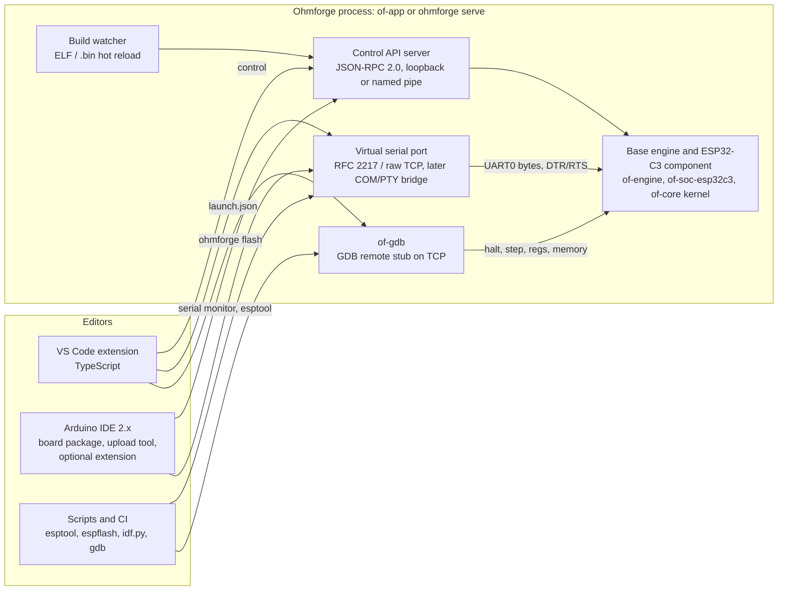

# Editor integration: VS Code and the Arduino IDE

Status: proposed (design only, no code). Nothing in this document is implemented yet; section 1 lists what exists today. Phases I1 to I4 are planned in P3 / 0.2, I5 and I6 in P4 / 0.3 and I7 in P6 (section 6).
Date: 2026-11-23.
Related: [`DESIGN_AND_PLAN.md`](../DESIGN_AND_PLAN.md) §8 (firmware loading, steps 1 to 6), §9 (user interface and instruments), §13.1 (licensing); [`engine-components.md`](engine-components.md) (the base engine, the ESP32-C3 component and circuit files this builds on); [`arduino-idf-mvp-demos.md`](arduino-idf-mvp-demos.md) (P2 committed Arduino/ESP-IDF MVP test firmware, #60 — not I6); roadmap items “`of-gdb`” (phase one), “Flash like real hardware” (P3) and “Editor integration” (P3, P4, P6).

Ohmforge is a simulator, not an editor. People write ESP32 firmware in VS Code (often with the ESP-IDF or PlatformIO extensions) or in the Arduino IDE 2.x, and they expect to press Upload, open a serial monitor and start a debugger. This note plans how those editors drive Ohmforge the way they drive a real board: a small shared foundation in the simulator (a control API, a virtual serial port, a GDB stub and a build watcher), a VS Code extension, and Arduino IDE support through a board package. The plugins never link Rust code; they talk to the running simulator over local sockets.

## 1. Current state

What exists on `main` (23 November 2026), and what each later piece builds on:

| Piece | Where it lives today | Used by |
|---|---|---|
| ELF reader (segments, symbols, sections) | `of-firmware::elf` (`ElfImage`) | Loading firmware from a build folder (I4); symbols for the debugger (I3) |
| ESP image parser and writer (`EspImage`: header, segments, checksum, SHA-256), partition tables (`PartitionTable`) | `of-firmware` | Writing bootloader, partition table and app into the simulated flash (I1 fast upload) |
| Direct ELF boot (`Esp32c3::load_elf`), flash image boot (`load_flash_image`), ROM-lite flash boot (`boot_flash`), real-ROM boot (`power_on_rom`, ROM fetched by `scripts/fetch-esp-rom-elfs.*`, never committed) | `of-soc-esp32c3` (`soc.rs`, `boot.rs`, `rom.rs`) | Reset and run after an upload (I1, I2) |
| Strapping (`GPIO_STRAP_REG`: `STRAP_SPI_BOOT`, `STRAP_DOWNLOAD`); the real ROM honours download strapping (`tests/rom_boot.rs`) | `of-soc-esp32c3::bus` | The ROM serial loader behind the virtual port (I2) |
| SPI flash chip with page program, sector, block and chip erase (instant, no busy time) | `of-soc-esp32c3::flash` | Flash writes through the ROM loader (I2) and direct writes (I1) |
| UART0 TX log (`uart_bytes`, `uart_text`) and baud-timed RX (`push_uart_rx`, #30); USB Serial/JTAG console (TX capture only) | `of-soc-esp32c3` (`uart.rs`, `usb_serial.rs`) | The virtual serial port and serial monitors (I2) |
| Hart debugger API: `step`, `run`, `run_until`, breakpoints, `halt`/`resume`/`reset`, `reg`/`set_reg`, `csr_peek`/`csr_poke`, `disassemble_at` | `of-cpu-riscv` (`hart.rs`; `AGENTS.md` “Debugger/GDB”) | The GDB stub (I3) |
| Kernel with quantum slices, events, breakpoints and host stops; virtual time in u64 ps | `of-core` (`Kernel`, `SimTime`) | Pausing virtual time for the debugger and the control API |
| GDB remote stub | `of-gdb` (empty placeholder crate; the plan names the `gdbstub` crate) | I3 |
| Headless runner: `ohmforge run <netlist.cir>` (SPICE decks only) and `ohmforge validate-parts` | `of-cli` | Grows a `serve` mode and upload commands (I1) |
| Desktop app with demo picker, live playback, serial monitor (TX log, Send to UART0 RX, hex view, find) | `of-app`, `of-ui` | Hosts the same control server as the CLI (I1) |
| Base engine with components (`of-engine`, first E2 slice); the ESP32-C3 component (E3, #47) and circuit files (E4, #48) are still to do | `of-engine`, `of-component-api` | “Open project” and readings through the engine (I1) |

What does not exist: any network listener, any way for an outside program to load firmware or reset the chip, a virtual serial port, the auto-reset circuit (DTR/RTS to EN and GPIO9), the GDB stub, a build-folder watcher, or any editor plugin.

## 2. Goals and non-goals

Goals:

- Use the firmware workflow people already have. Arduino IDE 2.x, VS Code with ESP-IDF or PlatformIO, and plain `esptool`, `espflash` or `idf.py` upload to the simulator the way they upload to a board, and their serial monitors and debuggers work against it.
- One foundation for every editor. Both plugins (and scripts, CI and future editors) use the same control API, the same virtual serial port and the same GDB stub; editor-specific code stays thin.
- No linking across the boundary. Plugins talk to Ohmforge over local sockets, so the plugin languages (TypeScript, Arduino platform files) and their licences stay separate from the Rust workspace, and editor crashes cannot take the simulation down (or the other way round).
- Faithful by default where it matters, fast where it does not: a real-ROM upload path for realism and tests, and a direct flash-write path for the everyday edit, upload, run loop.
- Deterministic: an upload, a reset or a debugger pause happens at a defined virtual time and is logged, so a run can be replayed.
- Local only and safe: listeners bind to loopback (or a named pipe / Unix socket) and need a per-session token.

Non-goals:

- An editor, code completion, a compiler or a build system inside Ohmforge. The toolchains (ESP-IDF, Arduino-ESP32, PlatformIO, esp-hal with cargo) stay where they are. This is a firm decision for P2 to P6: Ohmforge is a simulator, not a firmware IDE. An in-app sketch editor would be a new future-ideas item, not a silent addition to I5–I7 (see [`ROADMAP.md`](../ROADMAP.md)). The planned part creator ([`part-creator.md`](part-creator.md)) is a separate tool for authoring library parts (symbols, models, citations); it is not a firmware editor and not the circuit schematic editor.
- Redistributing Espressif toolchains, cores or tools. The plugins find what the user has installed (section 5d).
- Remote or multi-user access to a running simulator. The control API is a local developer tool; the web app (`of-web`, P4) has its own path.
- A stable public protocol before P6. The control API is versioned from the start but may change until 1.0, like the component API.
- Support for editors other than VS Code and Arduino IDE 2.x in this plan (Arduino IDE 1.x is end-of-life; other editors can use the same foundation later).

## 3. Architecture

All four services run inside the process that owns the simulation: the desktop app (`of-app`, so the user sees the schematic while the editor drives it) or a new headless mode of the CLI (`ohmforge serve`, for CI and for editors that want no window). The services sit outside the simulation crates: the simulation crates stay free of OS and network dependencies and keep building for `wasm32-unknown-unknown`.

## 4. Shared foundation

### 4a. Headless mode and the control API (I1)

**Proposed.** A control server that any client can use to drive one simulator session.

- **Hosts.** `ohmforge serve [--project DIR] [--listen ADDR]` in `of-cli` (headless), and the same server inside `of-app` behind a setting or `--listen`. One session per process; a second client gets a clear “session busy” error unless it attaches read-only.
- **Transport.** JSON-RPC 2.0, newline-delimited, over a Windows named pipe or a Unix domain socket by default, or TCP on `127.0.0.1` (needed by the Arduino IDE tool and by clients that cannot open pipes). JSON-RPC is chosen because VS Code's own tooling uses it (`vscode-jsonrpc`), it is trivial from a shell script, and it needs only `serde_json` on the Rust side.
- **Discovery and auth.** On start the server writes a session file (`ohmforge-session.json` in the platform runtime directory: address, pid, protocol version, random token) readable only by the user. Every request carries the token. The file is removed on exit.
- **Crate placement.** Protocol types (requests, responses, notifications, error codes) in a new transport-free crate, working name `of-control` (serde only, wasm-clean); the server loop in a host crate (`of-cli`, reused by `of-app`). A JSON Schema of the protocol is generated from the types (the same schemars approach planned for `part.toml`) and checked into `docs/` so the TypeScript client can generate its types from it.
- **Methods** (first set; names illustrative):

| Group | Methods | Notes |
|---|---|---|
| Session | `session.info`, `session.shutdown` | Protocol version, Ohmforge version, chip, ROM present or not |
| Project | `project.open` (circuit file, E4), `project.openDemo` (blink, dimmer, fade, button, until E4), `project.save` | Flash contents and settings persist with the project |
| Firmware | `firmware.load` (ELF: direct boot), `flash.write` (image or bootloader + partition table + app at offsets), `flash.read`, `flash.erase` | `flash.write` is the fast upload path: it writes the SPI flash model directly, verifies with `EspImage::parse` and MD5, then resets |
| Run control | `sim.run`, `sim.pause`, `sim.reset` (power-on, EN pin, or into download mode), `sim.setSpeed`, `sim.state` | Pauses land on a quantum boundary at a reported virtual time |
| UART | `uart.subscribe` (notifications of TX bytes), `uart.send` | A convenience for clients that do not want the virtual port |
| Readings | `readings.list`, `readings.get`, `readings.subscribe` | Through the E5 measurement service once it exists; before E5, the demo readouts `of-ui` already has |
| Events | notifications `sim.stopped`, `sim.reset`, `firmware.loaded`, `log` | For status bars and test runners |

- **Determinism.** Every mutating call is applied at the next quantum boundary and recorded with its virtual time, ready for the planned `of-core` replay log (#57).

### 4b. Virtual serial port and auto-reset (I2, the P3 “Flash like real hardware” item)

**Proposed.** Expose the simulated UART0 to host programs as if a USB-serial adapter were plugged in.

- **Transports, in order.** (1) RFC 2217 (Telnet COM-port control) on `127.0.0.1`: `esptool` and `idf.py` accept `rfc2217://host:port` as a port name, and RFC 2217 carries baud rate and the DTR/RTS lines. (2) Raw TCP for simple monitors. (3) A host bridge that shows up as a real serial device: a PTY on Linux and macOS (no driver needed), and a COM port on Windows (needs a virtual COM driver; see section 8).
- **Auto-reset circuit.** Model the classic dev-board circuit (two transistors from DTR and RTS to EN and GPIO9) as components in the circuit, so the esptool reset sequence pulls GPIO9 low while EN rises and the real ROM enters download mode through the strapping that already works. Without the full circuit (headless demos), a simpler built-in mapping gives the same pin behaviour.
- **Baud and timing.** Bytes enter and leave UART0 at the baud the firmware programs, in virtual time (as #30 does for RX). The ROM loader's baud change and esptool's RAM stub must work unmodified.
- **What it enables.** Unmodified `esptool write_flash`, `idf.py flash`, the Arduino IDE's esptool upload and any serial monitor (Arduino, VS Code, PuTTY, `idf.py monitor`) work against the simulator. `espflash` and tools that only open OS serial ports need the COM/PTY bridge.
- **Later.** The C3's USB Serial/JTAG peripheral as a second port (today only its TX is captured), so firmware that uses the USB console and tools that flash over it work too.

### 4c. GDB remote stub (I3, `of-gdb`)

**Proposed**, building on the existing hart debugger API.

- `of-gdb` implements the GDB remote serial protocol with the `gdbstub` crate (named in `DESIGN_AND_PLAN.md` §8 step 6 and §16), on TCP `127.0.0.1:<port>` (`target extended-remote`).
- Target: RV32IMC registers and CSRs with a target description XML; memory reads and writes through the SoC bus (so peripheral registers are visible); software breakpoints through the existing breakpoint set; hardware watchpoints once the roadmap's debug-trigger item (`tselect`/`tdata1`/`tdata2`) lands.
- **Virtual time stops while halted.** A breakpoint stops the hart, and the kernel stops the analog engine at the same virtual instant (a host stop), so the circuit does not move on while the user reads variables. Resuming continues from the same instant.
- Works with any RISC-V GDB: `riscv32-esp-elf-gdb` ships with ESP-IDF and with the Arduino-ESP32 core's tools, so users already have it. DWARF symbols come from the user's ELF in GDB itself; Ohmforge does not need `gimli` for this (it stays planned for Ohmforge's own debugger panel).
- `monitor` commands for Ohmforge actions (`monitor reset halt`, `monitor speed 0.1`), matching the OpenOCD names editors already send where that is sensible.

### 4d. Build-folder watch and hot reload (I4, DESIGN step 5)

**Proposed.** Watch a firmware build output (an ELF, or a flash image set) and reload it when it changes.

- Debounced file watch in the host crate (a `notify`-style crate; licence checked by `cargo-deny`), never in simulation crates.
- **What reload keeps.** The circuit state stays: capacitor voltages, the pot position, the PSU set point, instrument history. The chip gets the new firmware and a power-on reset (or an EN reset, chosen per project). A true “keep CPU state” reload is out of scope; firmware state cannot be carried across a rebuild safely.
- Clients learn about reloads through the `firmware.loaded` notification; the desktop app shows it in the status line.

## 5. Editor plugins

### 5a. VS Code extension (I5, MVP)

**Proposed.** A TypeScript extension in this repository (`editors/vscode/`), published to the Visual Studio Marketplace and Open VSX.

**Commands:**

| Command | What it does |
|---|---|
| Ohmforge: Start Simulator | Starts `ohmforge serve` or `of-app --listen` (setting: headless or window), connects through the session file; status bar item with run state and virtual time |
| Ohmforge: Open Project / Demo | `project.open` or `project.openDemo` |
| Ohmforge: Upload Firmware | Fast path (`flash.write`) or faithful path (runs the user's `esptool` against the virtual port); picks the build output from the active ESP-IDF, PlatformIO or Cargo project, or asks |
| Ohmforge: Upload on Build | Toggle: uses the build watcher (I4) or a task dependency to upload after each successful build |
| Ohmforge: Run / Pause / Reset | Run control from the status bar and command palette |
| Ohmforge: Serial Monitor | A terminal (pseudoterminal API) bound to the virtual port or to `uart.subscribe`, with send support |
| Ohmforge: Open Schematic | MVP: brings the native `of-app` window to the front (or starts it). A webview comes in I7 |

**Debugging.** A debug type `ohmforge` in `launch.json`, provided by a `DebugConfigurationProvider` that starts or attaches to the simulator, loads the firmware, halts at reset and then hands over to an existing GDB front end:

- the Microsoft C/C++ extension (`cppdbg`, MI mode with `miDebuggerServerAddress` pointing at `of-gdb`), or
- `cortex-debug` with `servertype: external` and `gdbTarget` at the `of-gdb` port (it works with non-ARM GDBs, though its peripheral views assume SVD files; Espressif publishes an SVD for the C3).

Ohmforge does not ship its own Debug Adapter Protocol adapter in the MVP; a native DAP adapter (so variables can show circuit readings) is an I7 option.

**Tasks.** A `TaskProvider` with `ohmforge` tasks (`serve`, `upload`, `watch`) so users can chain them in `tasks.json` after their build task (`dependsOn`).

**Interop with the ESP-IDF and PlatformIO extensions** (configuration only, no API coupling):

- ESP-IDF: point `idf.port` (or `idf.py -p`) at the `rfc2217://127.0.0.1:<port>` URL so its Flash and Monitor buttons work unchanged; the extension offers to set this per workspace.
- PlatformIO: an `[env:ohmforge]` snippet with `upload_port = rfc2217://127.0.0.1:<port>` (or `upload_protocol = custom` with `ohmforge flash`), `monitor_port` the same, and `debug_tool = custom` with `debug_server` empty and `debug_port = localhost:<gdb port>`.
- Rust (esp-hal): a `runner` line for `.cargo/config.toml` that calls `ohmforge flash --run`, the simulator's equivalent of `espflash flash --monitor`.

**Licence decision: AGPL-3.0-or-later.** The extension is part of Ohmforge, so it takes the project's code licence, as `.github` workflows and scripts do. This is compatible on every side: the extension runs inside VS Code's extension host as a separate program that talks to Ohmforge over sockets, so it neither links nor is linked by Ohmforge's Rust code, and VS Code's own licence (MIT for Code-OSS, Microsoft's product licence for the VS Code build) places no conditions on extension licences; both marketplaces accept AGPL extensions. Its npm dependencies must be AGPL-compatible (MIT, ISC, BSD, Apache-2.0; no GPL-2.0-only), checked in CI by a licence checker, mirroring `cargo-deny`. MIT was considered: it would let others copy the client code into closed tools, but nothing in the extension needs that, and one licence for all code keeps the dual-licensing option in `DESIGN_AND_PLAN.md` §13.1 simple. If third parties want to embed a client, the protocol schema (documentation, CC-BY-SA-4.0) is enough to write one; a permissively licensed client library is an open question (section 9).

### 5b. Arduino IDE 2.x board package (I6)

**Proposed.** A board package in this repository (`editors/arduino/`) and a Boards Manager index, `package_ohmforge_index.json`, published with each release (for example on GitHub Pages), that users add under Preferences, Additional boards manager URLs.

- **Board.** One platform, `ohmforge:esp32sim`, with one board, “Ohmforge simulated ESP32-C3”. Its `boards.txt` reuses Espressif's core and toolchain through Arduino's cross-platform references (`build.core=esp32:esp32`, the `esp32c3` variant and the `esp32:` tools), so sketches compile with the user's installed `esp32:esp32` platform exactly as for an ESP32C3 Dev Module. Arduino references share the core, variant and tools, not the build recipes, so `platform.txt` carries the ESP32-C3 compile recipes, generated by a script from a pinned, tested `esp32:esp32` release and checked in CI (section 9 has the alternative if that proves too brittle).
- **Prerequisite.** The index format has no platform-to-platform dependency, so the board needs the user to install “esp32 by Espressif Systems” first; the board's documentation and an early compile check (a clear error if `esp32:esp32` is missing or an untested version) cover this.
- **Port discovery.** A small pluggable discovery tool (`ohmforge-discovery`, part of the Ohmforge release, a few hundred lines of Rust on the Arduino pluggable discovery protocol) reads session files and lists running simulators as ports with protocol `ohmforge` (label “Ohmforge: <project>”), so they appear in the IDE's port menu next to real boards.
- **Upload.** `upload.tool.ohmforge=ohmforge_upload`; the recipe calls the Ohmforge CLI, `ohmforge flash --session <port address> --bootloader {build.path}/{build.project_name}.bootloader.bin --partitions {build.path}/{build.project_name}.partitions.bin --app {build.path}/{build.project_name}.bin`, which uses the fast `flash.write` path. A board menu option (“Upload path: fast / through the ROM”) switches to the user's `esptool` from the esp32 core against the RFC 2217 port, for a faithful upload.
- **Serial monitor.** A pluggable monitor for protocol `ohmforge` (`ohmforge-monitor`) that bridges the IDE's monitor and serial plotter to the virtual port, baud setting included.
- **Debugging.** Arduino IDE 2's debugger is built on cortex-debug and configured through `debug.*` properties; the board sets them to use `riscv32-esp-elf-gdb` from the esp32 core against `of-gdb` as an external server. Whether the current Arduino CLI accepts an external GDB server without OpenOCD needs a spike (section 9).
- **Tools in the index.** `ohmforge` (CLI with `flash`, discovery and monitor) per host (Windows x86-64, macOS arm64 and x86-64, Linux x86-64 and arm64) from Ohmforge's release artefacts, with checksums, under AGPL-3.0-or-later with a source link.

**Licences and redistribution.** Arduino-ESP32 (the core) is LGPL-2.1; its GCC toolchain is GPL-3.0 with the GCC runtime library exception; `esptool` is GPL-2.0-or-later. Ohmforge does not redistribute any of them and does not link them: the board package refers to the user's installed `esp32:esp32` platform, and `esptool` runs as a separate program. The firmware the user builds contains the LGPL core, as it does on hardware; that is the user's binary, which Ohmforge only executes, the same as any other firmware (no third-party firmware is ever committed, `DESIGN_AND_PLAN.md` §13.1). The board package files themselves are ours (AGPL-3.0-or-later). Trademarks: the board is described as “simulated ESP32-C3” and uses no Espressif or Arduino logos.

### 5c. Arduino IDE 2 extension (I7, optional)

**Proposed, later.** Arduino IDE 2 is built on Eclipse Theia and loads VS Code extensions (`.vsix` files placed in `~/.arduinoIDE/plugins/`), with a subset of the VS Code API. A trimmed build of the VS Code extension (status bar, run control, Open Schematic, readings view) can therefore also serve the Arduino IDE; commands that depend on ESP-IDF or PlatformIO stay off. It is optional because the board package (I6) already covers upload, monitor and debug.

### 5d. Finding the user's tools

The plugins locate, in order: an explicit setting, the active ESP-IDF or PlatformIO environment, the Arduino data directory's `packages/esp32/tools/`, then `PATH`. Ohmforge itself is found the same way (setting, then `PATH`, then the default install location). Nothing is downloaded silently.

## 6. Phasing

Each item lands in small PRs with tests. The foundation (I1 to I4) is in P3 because it is also what the P3 “Flash like real hardware” item needs; the plugins follow when the foundation is usable.

| Item | Phase | Work | Depends on | Acceptance criteria |
|---|---|---|---|---|
| **I0** Design | P2 (now) | This document; roadmap, README and mdBook pointers. | — | Reviewed and merged by Stefan. No code change. |
| **I1** Control API and headless mode | P3 | `of-control` protocol types and schema; `ohmforge serve`; the same server in `of-app`; session file and token; firmware, flash, run-control, UART and readings methods; `ohmforge flash` client. | E3 (#47) for a chip component; E4 (#48) for `project.open` (demos until then); E5 (#49) for general readings | A CLI integration test starts `ohmforge serve`, writes the esp-hal blinky flash image with `flash.write`, resets and sees the banner on `uart.subscribe` and the LED edges in readings; requests without the token are refused; the server binds loopback only; wasm32 check of simulation crates unchanged. |
| **I2** Virtual serial port and auto-reset | P3 (the “Flash like real hardware” item) | RFC 2217 and raw TCP port; DTR/RTS auto-reset circuit; baud changes; PTY bridge on Linux and macOS; Windows COM bridge investigated. | E3; real ROM fetched; UART0 RX (#30) | Unmodified `esptool --port rfc2217://… write_flash` and `idf.py flash` write a merged image through the real ROM loader and esptool's stub, the app then boots from the written flash, and `esptool verify_flash` passes; a serial monitor sees the app's output; test runs in CI where the ROM is available (`OF_REQUIRE_ESP_ROM=1`). |
| **I3** `of-gdb` | P3 (the phase-one roadmap item, scheduled here) | `gdbstub` target for the C3 hart; registers, memory through the bus, breakpoints, halt with virtual time stopped, `monitor` commands; watchpoints after the debug-trigger item. | Hart debugger API (exists); kernel host stops (exist); E3 for the component wiring | `riscv32-esp-elf-gdb` (or `gdb-multiarch`) connects, breaks at `main` of the esp-hal blinky, steps, reads a variable and a GPIO register, continues; while halted, virtual time and the analog solution do not change; a scripted GDB session runs in CI if a RISC-V GDB is available there. |
| **I4** Watch and hot reload | P3 | Build-folder watcher in the host crate; reload with circuit state kept; `firmware.loaded` notification. | I1 | Rebuilding the blinky with a different period while the dimmer circuit runs reloads it within one second of wall time, the pot position and PSU set point are unchanged, and the new period shows on the LED trace. |
| **I5** VS Code extension MVP | P4 | Commands, status bar, serial monitor, `ohmforge` debug type via `cppdbg` or cortex-debug, task provider, ESP-IDF/PlatformIO/Cargo snippets; CI build, tests (`@vscode/test-electron`) and licence check; Marketplace and Open VSX publishing. | I1 to I4 | From a fresh ESP-IDF or esp-hal blink project: Start, Upload, see output in the serial monitor, hit a breakpoint, change code, rebuild and see the change, without leaving VS Code; extension tests run headless in CI on Linux. |
| **I6** Arduino IDE board package | P4 | `package_ohmforge_index.json`, `ohmforge:esp32sim` platform, generated `platform.txt`, discovery and monitor tools, upload recipe (fast and ROM paths), debug properties. | I1, I2 (ROM path), I3 (debug) | In Arduino IDE 2.x with `esp32:esp32` installed: install the Ohmforge board from the index URL, pick the simulator port, upload the Blink and AnalogReadSerial examples, see Serial output in the monitor and plotter; `arduino-cli compile` and `upload` against the board run in CI. This also delivers the P2 MVP's “Arduino-ESP32 ELF” demo path for users. |
| **I7** Rich views | P6 | Schematic and instruments in a VS Code webview (the `of-web` wasm build from P4 hosted in the webview, so no second UI); readings in the debugger's variables view (DAP adapter or `evaluate` requests); the trimmed extension for Arduino IDE 2. | I5; `of-web` (P4); E4 to E6 | The webview shows the live schematic of the running session and stays in sync with the native window's state; the Arduino IDE 2 extension installs from a `.vsix` and shows run state and readings. |

I5 and I6 were placed in P4 rather than P3 because P3 already carries E4 to E6, the classic ESP32 and the foundation itself; if the foundation lands early, I6 is small and can move into P3 (it is the piece Arduino users will notice most).

## 7. Invariants

1. **No linking across the boundary.** Plugins and helper tools reach Ohmforge only through the control API, the virtual port and the GDB stub. No editor code is linked into a Rust crate and no Rust crate is loaded into an editor.
2. **Simulation crates stay clean.** Listeners, file watchers and OS serial bridges live in host crates (`of-cli`, `of-app`, or a new host-only crate), never in `of-core`, `of-analog`, `of-soc-esp32c3` or `of-engine`; the wasm32 check keeps passing.
3. **Local and authenticated.** Loopback or pipe/socket only, token required, session file user-readable only.
4. **Defined virtual time.** Every external action (upload, reset, pause, DTR/RTS change, GDB halt) applies at a recorded virtual time; replaying the log gives the same run.
5. **Same firmware path as hardware.** The faithful upload path goes through the real ROM loader; the fast path writes the same bytes to the same flash offsets, so a project behaves the same whichever path loaded it.
6. **Nothing redistributed.** No Espressif core, toolchain, `esptool`, ROM or bootloader binaries in the repository, the board package or the extension.

## 8. Risks

| Risk | Impact | Mitigation |
|---|---|---|
| Realtime factor (about 0.17 to 0.23× on the busy demos today, #61) makes ROM-path uploads slow: a 1 MB image at 460800 baud is about 25 s of virtual time | Uploads through the ROM can take minutes of wall time | The fast `flash.write` path is the default for editors; the ROM path is for realism and tests; esptool's compressed writes and high baud rates help; the CPU mostly idles in the loader, which the quiescent-slice work (#44) already speeds up |
| esptool's RAM stub and the ROM loader exercise peripherals and timing the model does not have yet | ROM-path flashing fails | I2's acceptance test pins the esptool version; fall back to `--no-stub` while gaps are fixed |
| Windows virtual COM ports need a kernel driver (signed); the usual open-source one, com0com, is GPL-2.0 and must not be bundled | `espflash` and COM-only tools do not work on Windows without extra setup | RFC 2217 covers esptool, `idf.py`, the Arduino upload and our monitor; document an optional user-installed driver; do not ship a driver |
| Arduino platform references share the core but not recipes | The `platform.txt` copy drifts from Espressif's releases | Generate it from a pinned release, test compile in CI, warn on untested `esp32:esp32` versions; fallback in section 9 |
| Arduino IDE 2 debugging may expect OpenOCD | No debugging from the Arduino IDE in I6 | Spike early; ship I6 without debug if needed (VS Code and command-line GDB still work) |
| Arduino IDE 2's VS Code API subset lacks something I7 needs (webviews, terminals) | The optional extension is limited | Keep I7 optional; feature-detect APIs at run time |
| A local control port is an attack surface | Another local process could load firmware or read the session | Loopback/pipe only, token, user-only session file, no file-system methods beyond the project directory |
| Third-party extension licences or marketplace terms change | Publishing friction | Publish to both Marketplace and Open VSX; the `.vsix` is always attached to the GitHub release |

## 9. Open questions

1. **Arduino board shape.** Own board (`ohmforge:esp32sim`, generated `platform.txt`), as proposed, or no own board: users select Espressif's stock “ESP32C3 Dev Module” and only the Ohmforge port discovery, monitor and an `upload.tool.ohmforge` mapping are added? The second needs no recipe copy but depends on Arduino CLI resolving an upload tool for a port protocol the board does not declare. Proposal: spike both in I6, prefer the stock board if it works.
2. **Control transport default.** Named pipe / Unix socket first (better isolation) or TCP first (one code path, reachable by the Arduino tools and from WSL)? Proposal: both from I1, TCP used by the tools.
3. **Client library licence.** Is a permissively licensed (MIT) TypeScript client for the protocol wanted, so other tools can embed it, while the extension stays AGPL? Proposal: not before P6; the schema is enough.
4. **One process or many.** One simulator per project window, or one daemon hosting several sessions (several boards talking over the P4 Wi-Fi radio)? Proposal: one session per process now; multi-board sessions with the Wi-Fi work.
5. **USB Serial/JTAG.** Many C3 boards (SuperMini, DevKitM-1 with USB) flash over the built-in USB, not UART0. When does the virtual port get a USB-CDC personality, and does that need a JTAG model for OpenOCD as well? Proposal: CDC console in P3 after I2, JTAG not planned.
6. **Hot reload semantics.** Power-on reset or EN reset after reload, and should RTC memory survive (it does on a real EN reset)? Proposal: EN reset, RTC memory kept, configurable.
7. **Where the plugins live.** In this repository (`editors/`), as proposed, so protocol changes and plugin changes land together, or in their own repositories with their own release cadence? Proposal: in this repository until the protocol is stable (P6).
8. **Debugger front end in VS Code.** `cppdbg` (widely installed, but the C/C++ extension's binaries are licensed for Microsoft's VS Code only, which matters for VSCodium users) or cortex-debug (MIT, works in VSCodium and Arduino IDE 2)? Proposal: support both, default to cortex-debug.
