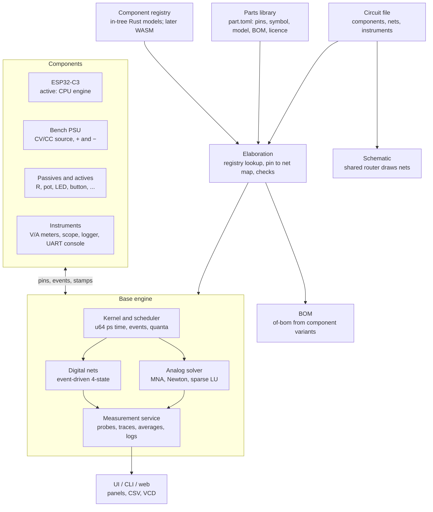

# Base engine and plug-in components

Status: E1 (this document) merged in #43. The PSU return and current-averaging fix (#45) landed in #54. E2 and E3 are next in P2 (#46, #47). E4 to E6 are planned in P3 / 0.2 (#48, #49, #50). The engine API itself is not implemented yet; section 1 lists the existing pieces, including the #54 PSU routing and averaging work.
Date: 2026-11-22 (status updated 2026-11-23).
Related: [`DESIGN_AND_PLAN.md`](../DESIGN_AND_PLAN.md) §5 (mixed-signal co-simulation), §6 (system architecture), §7 (component model and library), §11 (BOM); [`wire-routing.md`](wire-routing.md) (the shared schematic router); [`COMPONENTS.md`](../COMPONENTS.md) (the parts the library should grow to); roadmap P2 item “Base engine and plug-in components”.

This note specifies how Ohmforge is split into a **base engine** that stands in for the real world (nets, physics, time, measurement) and **components** that plug into it. Every part with a real-world counterpart is a component that follows one engine API: resistors, LEDs, pots and buttons, the bench PSU, and the ESP32-C3 itself. Wiring, readings, logging and measuring are engine services, so instruments work the same way on every circuit. A demo stops being hand-written glue code and becomes a circuit file: a list of components plus the nets between them.

## 1. Current state

Most of the pieces exist; what is missing is one API that joins them. Today each demo assembles its simulation by hand in `of-ui`.

| Piece | Where it lives today | Maps to |
|---|---|---|
| Virtual time (`SimTime`, u64 ps), `Scheduler`, `Engine` trait, `Kernel` (quantum slices, events, breakpoints, host stops) | `of-core` | Engine core: time and scheduler (kept as is) |
| MNA solver, Newton, sparse LU, transient with LTE control; `Device` trait (`setup`, `load`, `probes`, `set_param`, breakpoints); `AnalogEngine` (events to `SetParam`, threshold watches, `sample_on`) | `of-analog` | Engine core: analog solver; `Device` is the stamping level components elaborate into |
| 4-state `Logic` type; `NetDomain` (digital or mixed) | `of-digital`, `of-netlist` | Engine core: digital nets (still mostly to do) |
| `Component` trait (`describe`, `commit -> Health`, `faults`), `ComponentInfo`, `Health`, `FaultKind` | `of-component-api` (draft) | Component API (to be extended; nothing implements it for real yet, `of_components::Resistor` is a stub) |
| Parts bridge: `Library`, `Board` of `Placement`s (refdes, part id, pin-to-net map, parameter overrides), `build` to an `of_analog::Circuit`, `BuiltBoard::pot_params` / `switch_param`, `to_spice` | `of-components::analog` | Elaboration of passive parts (reused) |
| `part.toml` schema: pins, `[electrical]` ratings, `[analog]` model with min/typ/max/tol, `[[variant]]` (MPN, manufacturer, footprint, offers), `[license]` | `of-parts`, `parts/` | Parts library (extended with symbol and component fields) |
| `Esp32c3` SoC and `Esp32c3Engine` (pin changes as kernel events, `link_pin`, `link_input`, `link_adc`, PWM edges at exact ticks, deferred input reads) | `of-soc-esp32c3` | The ESP32-C3 component wraps it |
| GPIO half-bridge `PinDriver`s (`add_pin_drivers`, `pin_actions`), `hook_pin`, V_IH/V_IL `watch_relative` setup | `of-ui` (`pins.rs`, each demo module) | Moves inside the ESP32-C3 component |
| Bench PSU: `add_supply` (Thevenin `psu` from `vdd` to node 0, current source `psu_cc`), CV/CC switching in `regulate`, `SupplyStatus`; schematic `+`/`−` pins with `−` routed to GND; `source_return_paths` and `label-on-body` checks; face and sidebar show period-averaged current (`display_amps`) | `of-ui` (`supply.rs`) | PSU component |
| Meters: `CircuitReadout` filled per demo (`add_led_series`, `add_resistor`, `add_psu`), `read_meter` | `of-ui` (`meters.rs`) | Measurement service plus meter instruments |
| Scope ring, period-aligned PWM averages, PWM duty and frequency | `of-ui` (`trace.rs`) | Measurement service (trace store) |
| Serial monitor model | `of-instruments::serial` | UART console instrument |
| BOM lines, ZAR totals, CSV | `of-bom` | BOM from components |
| Schematic model (components with body rects and pins, nets, keepouts) and the shared router | `of-ui::wiring` (`blink.rs`, `dimmer.rs`, `button.rs`, `router.rs`) | Drawn from the circuit file |

The problems this causes:

- **Each demo describes its circuit twice.** The electrical `Board` (in `blink/simulation.rs`, `adc_pwm.rs`, `button.rs`) and the schematic `Schematic` (in `wiring/*.rs`) are separate hand-written lists that have to agree. The PSU and the GPIO drivers are not in either list; they are added afterwards with `add_supply` and `add_pin_drivers`.
- **Hidden ground connections.** The PSU's negative side and the GPIO low-side drivers connect to solver node 0 inside helper code, so the return path is real in the maths but invisible in the schematic (the PSU minus-terminal issue fixed on the paused `p2-psu-return` branch).
- **Engine glue in a UI crate.** Pin links, threshold watches, event codes and engine registration order live in `of-ui`, so the headless CLI and the future web app cannot reuse them.
- **Measurements are per demo.** Every branch current a meter can read is registered by hand; adding a part means touching the meter code.
- **New parts need demo code.** There is no way to drop a part into a circuit without writing Rust in `of-ui`.

## 2. Goals and non-goals

Goals:

- One engine API that every real part follows, including the ESP32-C3 and the bench PSU. Adding a part means a `part.toml` plus a component model, with no UI or demo changes.
- The engine is the real world: it owns nets, the analog and digital solvers, simulated time, the event scheduler and measurement. It knows nothing about specific parts.
- No hidden connections. Every current leaves and returns through declared pins; ground is an explicit net.
- Wiring, readings, logging and measuring are engine services any instrument or the UI can use on any circuit.
- Circuits are data (a circuit file), drawn by the existing shared router.
- The BOM comes from the components in the circuit.
- Deterministic and wasm32-compatible, as every simulation crate already is.
- Output parity: the ported demos reproduce today's traces and wiring goldens.
- Room for later physics layers (thermal, electromagnetic) and telemetry without changing every component.

Non-goals (for now):

- A new solver. `of-analog` stays the single numeric core; components elaborate into its devices.
- A stable public plugin ABI. The API is in-tree and may change until P6 (“Stable component API and WASM SDK”).
- External or dynamically loaded plugins in P2. WASM plugins are a later option (section 10).
- The schematic editor itself (place, wire, waypoints). It builds on this work; it is not part of it.
- Changing the schematic look and feel. The circuit file feeds the same router and painters.

## 3. Architecture



### 3a. Engine core

The engine owns, and is the only owner of:

- **Nets and nodes.** Each net in the circuit file becomes one solver node (or a digital net). Exactly one net is the reference (ground, solver node 0); the circuit file names it. Components never see node 0 directly; they see their own pins.
- **The analog solver.** `of-analog`'s MNA, Newton-Raphson, companion models and LTE step control, run as today's `AnalogEngine` under the kernel. Nonlinear and reactive parts work through the existing `Device::load` path (linearised stamps each Newton iteration, trapezoidal/Gear-2 companion models for C and L).
- **Simulated time.** `of-core`'s `SimTime` and `Kernel`. No wall clock in any simulation crate.
- **Mixed-signal event scheduling.** Kernel events, threshold watches (analog to digital), parameter changes (digital to analog) and sample requests (an ADC conversion), as `AnalogEngine::watch_relative`, `on_code` and `sample_on` do today. The engine assigns event codes and targets; components ask for “tell me when this pin crosses 0.75 of that pin” instead of wiring codes by hand.
- **Deterministic stepping.** Active components (those with their own clock, such as a CPU) are registered before the analog solver automatically, so the rule “register CPU engines before the analog engine” is enforced by the engine instead of by each demo. Component order is the circuit file order, then reference designator; all maps are ordered (`BTreeMap`), and any randomness (switch bounce, later noise) comes from a per-component seed stored in the circuit.
- **Measurement.** See section 3f.

The engine core lives in a new crate, working name `of-engine`, which depends on `of-core`, `of-analog`, `of-digital`, `of-netlist`, `of-component-api` and `of-parts` (never on a UI crate). `of-ui`, `of-cli` and `of-web` drive it.

### 3b. Component API

A component is data (its `part.toml`) plus behaviour (a model implementing the component trait). The behaviour does five things:

1. **Declares pins and parameters.** Pins come from the part's `[[pin]]` list, parameters from `[analog]` / `[electrical]` with min/typ/max and tolerance, resolved at the run's corner exactly as `of_components::analog` does today.
2. **Elaborates into the solver.** At build time a component adds `of-analog` devices between its pins and any internal nodes it allocates: a resistor adds one `R`; a pot adds two legs split at the wiper; an LED adds the `led` diode; a PSU adds its source pair; a part with a new nonlinear model adds its own `Device` implementation (with `load` stamping the linearised companion model). This keeps one validated solver and reuses the existing bridge code. Elaboration may also register threshold watches and sample points on its own pins.
3. **Handles events.** Digital input changes, timers it scheduled, host commands (a user pressing SW1, turning RV1, changing the PSU set point) and replies such as a sampled voltage. In response it can change its devices' parameters (`set_param`, same matrix pattern) or schedule events.
4. **Commits accepted steps.** After each accepted step it can update internal state (stored charge for a battery, a junction temperature), check ratings from `[electrical]` against what it sees, and return `Health` (`Ok`, `Warning`, `Damaged`), as the draft trait already sketches.
5. **Reports measurements.** Every component can report the current into each of its terminals and any internal quantities (an LED's optical power through the existing `popt()` probe, a PSU's mode). The measurement service uses these, so meters no longer need per-demo branch registration.

Components that keep their own time (a CPU, later an I2C sensor with internal timing) are **active**: they also provide an `of_core::Engine`, which the engine registers in the kernel before the analog solver.

Draft trait sketch (**illustrative, draft; names and signatures will change in E2**):

```rust
// DRAFT: illustrative only, not a committed API.
use of_core::{Engine, SimTime};

/// One pin of a placed component, resolved to a net by the engine.
pub struct PinSpec { pub name: String, pub kind: PinKind }      // passive, power, input, output, bidir

/// Static description of a placed component.
pub struct ComponentInfo {
    pub part_id: String,          // "generic.led-red-0603"
    pub refdes: String,           // "D1"
    pub pins: Vec<PinSpec>,       // in part.toml order
}

/// What a component may do while it is being built into the engine.
pub trait ElabCtx {
    fn pin_node(&self, pin: &str) -> NodeRef;                    // never node 0 unless that pin is on the ground net
    fn internal_node(&mut self, name: &str) -> NodeRef;          // "<refdes>.<name>"
    fn add_device(&mut self, dev: Box<dyn of_analog::Device>) -> DeviceRef;
    fn watch(&mut self, pin: &str, rel_to: Option<&str>, frac: f64, edge: Edge) -> WatchRef;
    fn sample_point(&mut self, signal: Signal) -> SampleRef;     // for ADC-style reads
    fn param(&self, name: &str) -> Option<f64>;                  // resolved at the run's corner
    fn seed(&self) -> u64;                                       // per-component, stored in the circuit
}

/// What a component may do when it handles an event or a host command.
pub trait EventCtx {
    fn now(&self) -> SimTime;
    fn set(&mut self, dev: DeviceRef, param: &str, value: f64);  // run-time change, same matrix pattern
    fn schedule(&mut self, at: SimTime, code: u32);
}

/// Behaviour of a simulated part (built-in Rust model or, later, a WASM plugin).
pub trait Component: Send {
    fn info(&self) -> &ComponentInfo;
    /// Add solver devices, internal nodes, watches and sample points.
    fn elaborate(&mut self, cx: &mut dyn ElabCtx) -> Result<(), ElabError>;
    /// Watches firing, scheduled timers, host commands, sample replies.
    fn on_event(&mut self, _ev: &ComponentEvent, _cx: &mut dyn EventCtx) {}
    /// Accepted step: state, dissipation, temperature, rating checks.
    fn commit(&mut self, _view: &SolutionView, _t: SimTime) -> Health { Health::Ok }
    /// Current into each pin (A), in `info().pins` order; must sum to zero.
    fn terminal_currents(&self, view: &SolutionView, out: &mut [f64]);
    /// Named internal readings, for example ("mode", 1.0) or ("popt", 1e-3).
    fn readings(&self, _view: &SolutionView, _out: &mut Vec<(String, f64)>) {}
    /// Faults the user can inject.
    fn faults(&self) -> &[FaultKind] { &[] }
    /// Optional physics layers (section 3j); `None` until a layer exists.
    fn thermal(&mut self) -> Option<&mut dyn ThermalPort> { None }
    /// Active components hand the engine their clocked engine (CPU, timers).
    fn take_engine(&mut self) -> Option<Box<dyn Engine>> { None }
}
```

Notes on the sketch:

- The original §7 sketch has `stamp_static` / `stamp_dynamic`. `of-analog`'s `Device` trait already provides that split (`setup` once, `load` each iteration), so components elaborate into `Device`s rather than stamping through a second matrix API. Whether a WASM plugin later gets a narrower stamp ABI is an open question (section 9).
- `terminal_currents` is required, not optional: it is what makes non-disturbing ammeters, the PSU current readout and the KCL check (section 4) work for every part.
- The ESP32 is not special-cased anywhere in the engine; it is the first active component.

### 3c. The ESP32-C3 as a component

`espressif.esp32-c3` wraps `of_soc_esp32c3::Esp32c3` and `Esp32c3Engine`. What the demos do by hand today moves inside it:

- **Pins.** The part declares the chip's (or module's) pins, including its supply pins (`3V3`, `GND`) and the GPIOs. Only pins that are on a net are elaborated.
- **GPIO outputs as sources.** Each connected GPIO elaborates the existing half-bridge: a high-side `PinDriver` from the component's own `3V3` pin to the GPIO pin and a low-side one from the GPIO pin to the component's own `GND` pin, with drive-strength resistances from `PinOut`. Today the low side goes to solver node 0 and the high side to the global `vdd` node; as a component, output current returns through the chip's `GND` pin, so the return path is visible and measurable. Pin events (`pin_code`) become `set` calls on those drivers (today's `pin_actions`).
- **GPIO inputs.** V_IH / V_IL watches relative to the component's own `3V3` pin (today's `watch_relative(…, "v(vdd)", 0.75 / 0.25)`), feeding `input_code` events; pulls stay in the analog pin model.
- **ADC as a probe.** Connected ADC pads register a sample point; a conversion start sends the request and the reply carries the node voltage at that instant (today's `link_adc` and `sample_on`).
- **Peripherals.** LEDC PWM edges stay exact-time pin events; UART0 TX/RX is exposed as a serial port that a UART console instrument (3f) can attach to; future I2C/SPI/RMT become ports of the same kind.
- **Supply current.** The chip draws current from its `3V3` pin through a supply-load model (a quiescent load first, from the datasheet; activity-dependent current later, which the P4 power profiler needs). Today the chip itself draws nothing; only the circuit hanging off its GPIOs does.
- **Firmware and boot.** Circuit-file parameters: the image (ELF, flash `.bin`), the boot path (direct, ROM-lite, real ROM; the ROM and bootloader stay fetched, never committed) and the CPU clock.
- **Active.** `take_engine` hands the kernel the `Esp32c3Engine`; the engine registers it before the analog solver.

Board-level parts (an ESP32-C3-DevKitM-1 with its USB regulator and LED, or a SuperMini) are later components that contain the chip component plus their own passives, or a sub-circuit file (open question 5).

### 3d. The PSU as a component

`bench.psu` is a bench supply with an explicit `+` and `−` terminal (and an optional earth terminal, open question 3).

- **CV mode:** a Thevenin source from `−` to `+` (set voltage, series resistance), as today's `psu` `PinDriver` but between its own two pins instead of `vdd` and node 0.
- **CC mode:** a current source from `−` to `+` at the current limit, as today's `psu_cc`.
- **Mode switching** happens in `commit` with the existing one-sample lag (`regulate`). A smooth CV/CC device without the lag is a later improvement and must keep the current goldens.
- **Off:** high impedance, as today.
- **Return path.** The `−` terminal is a real pin that must be on a net. In the demos it is on the ground net, which is what the paused `p2-psu-return` work draws and tests (the PSU minus pin routed onto GND, a check that every supply has both connections, and a test that the current out of `+` equals the current back into `−`). That fix stays valid; as a component the property is enforced for every source (section 4).
- **Readings:** voltage across `+`/`−`, current out of `+`, mode, and the rated-range warning (`rating_warning`, today against the ESP32-C3's 3.0–3.6 V; as a component it should warn against the ratings of whatever its `+` net feeds).
- **BOM:** a bench instrument, not a board part, so it is excluded from the BOM (`bom = false`, section 3g). A battery, USB 5 V source or wall adapter would be a BOM part.

### 3e. Passive and active parts

Ported first (E2), all through the existing bridge: `generic.resistor`, `bourns.ptv09a-b103` (pot; wiper `position` as a host command), `generic.led-red-0603`, `generic.pushbutton` (switch with the seeded bounce train from `of_components::bounce`). Then the rest of the existing library (`capacitor-mlcc`, `capacitor-tantalum`, `npn-small-signal`, `ams1117`, `bosch.bme280` supply load) and the parts in [`COMPONENTS.md`](../COMPONENTS.md). Mixed parts (a BME280 with I2C, a DHT11) are components with both analog supply pins and digital ports, which is the case the API's events exist for.

### 3f. Instruments, readings, logging and measuring

Measuring is an engine service; instruments are components (or probes) that use it.

- **Signals.** A `Signal` names anything measurable: a net voltage, a voltage between two nets, a component terminal current, a component reading (`popt`, `mode`, temperature), or a digital port state.
- **Measurement service.** Samples signals on a sampling plan (fixed step, at every event, or at exact instants), keeps bounded rings (today's `TraceBuf` with its capacity cap and window-tied retention), computes windowed averages aligned to whole periods of a detected PWM (the fix for the LED-current chatter on the paused branch), duty and frequency, and min/max/RMS. It lives in `of-instruments` (no egui), so the CLI and web app get the same numbers.
- **Instruments:**
  - *Voltmeter:* two probes; ideal by default, optional input resistance (10 MΩ) as a real meter would load the circuit.
  - *Ammeter:* non-disturbing by default (reads `terminal_currents`, so it works on any branch, not only the ones a demo registered); optional burden resistance inserted in series.
  - *Scope:* channels on signals, time/div, trigger, hold (today's live LED-current scope generalised).
  - *Logger:* records chosen signals to CSV or VCD (as `ohmforge run` does for SPICE decks).
  - *UART console:* attaches to a serial port of a component (today's `SerialMonitor` on UART0).
- Instruments are listed in the circuit file (section 3h) or placed by the user at run time; they are never in the BOM.

### 3g. Parts library

Each part keeps today's `part.toml` and gains what the engine and editor need:

- `[part]` `model` resolves to a registry entry (`rust:led`, `rust:potentiometer`, `rust:esp32c3`, `rust:bench-psu`; later `wasm:…`).
- `[[pin]]` already lists number, name and kind; kinds gain `power` and `ground` so supply pins are checked.
- `[symbol]` (new): the schematic symbol id and pin positions and directions, so the shared router can place the part (today these live in `wiring/*.rs`). Symbol artwork stays in the existing stroke language.
- `[[variant]]` already carries MPN, manufacturer, footprint and supplier offers; prices stay snapshots in ZAR (`of-bom`).
- `bom = false` (new, default true) for instruments and bench equipment.
- `[license]` stays: part data and artwork CC-BY-SA-4.0. Models in Rust are AGPL-3.0-or-later like all code.
- New parts needed for the ports: `espressif.esp32-c3` (chip or module; open question 5) and `bench.psu`.

### 3h. Circuit description file

A circuit is data. Working proposal: TOML, parsed with serde, which is the circuit half of the P0 roadmap item “Project file format v0 (`project.toml` + circuit file)”.

```toml
# DRAFT: illustrative only.
[circuit]
name = "Pot dimmer"
ground = "gnd"                     # the one reference net

[[component]]
ref = "U1"
part = "espressif.esp32-c3"
at = [120, 80]
params = { firmware = "firmware/esp32c3-esp-hal-adc-pwm/pot_dimmer.bin", boot = "rom" }

[[component]]
ref = "PSU1"
part = "bench.psu"
at = [300, 80]
params = { volts = 3.3, series_r = 0.1, current_limit = 0.5 }

[[component]]
ref = "RV1"
part = "bourns.ptv09a-b103"
at = [220, 60]
params = { position = 0.5 }

[[component]]
ref = "R1"
part = "generic.resistor"
at = [180, 140]
params = { resistance = 330 }

[[component]]
ref = "D1"
part = "generic.led-red-0603"
at = [180, 180]

[[net]]
name = "vdd"
kind = "power"
pins = ["PSU1.+", "U1.3V3", "RV1.3"]

[[net]]
name = "gnd"
kind = "ground"
pins = ["PSU1.-", "U1.GND", "RV1.1", "D1.K"]

[[net]]
name = "gpio8"
pins = ["U1.GPIO8", "R1.1"]

[[net]]
name = "led_a"
pins = ["R1.2", "D1.A"]

[[net]]
name = "gpio2"
pins = ["U1.GPIO2", "RV1.W"]

[[instrument]]
kind = "scope"
signal = "i(D1.A)"
```

- One file drives both the simulation and the schematic: elaboration builds the engine, and the same components (`at` plus the part's `[symbol]`) and nets feed the existing router in `of-ui::wiring`, which draws them exactly as today. Keepouts for labels stay schematic data in the file.
- The router, routing order (power, ground, fanout, name), hops and goldens do not change; they get their input from the file instead of `wiring/*.rs`.
- Waypoints and saved routes join the file with the editor (wire-routing PR 6).

### 3i. Plugin model

- **Now (P2): in-tree, compile-time registration.** Built-in models are Rust types registered in a static table (`Registry`) keyed by the `model` string, returning `Box<dyn Component>`. No new dependency (no `inventory`/`linkme` needed for a handful of parts). Lives in `of-components` (and the ESP32-C3 wrapper next to `of-soc-esp32c3`, or in `of-components` depending on it).
- **Later (P6): sandboxed WASM plugins** through `of-plugin-wasm`, as `DESIGN_AND_PLAN.md` §7 already plans: no file or network access, fuel-limited, deterministic, analog access through read-node-voltage, set-Norton/Thevenin-source and declare-dissipated-power calls. The runtime must be AGPL-compatible and pass cargo-deny (and should run inside the wasm32 web build too). Whether third-party plugins have licence obligations towards the AGPL host is for an RFC before P6.
- **Not planned:** native dynamic libraries (no stable Rust ABI, no sandbox).
- **Never:** linking ngspice or vendor simulators. ngspice stays an external tool for golden data only.

### 3j. Extension points: physics layers and telemetry

The parked “Physics interaction layers” idea (thermal, electromagnetic; toggleable; tiered beginner to engineer) plugs in through optional component capabilities rather than changes to every part:

- **Thermal:** a component exposes a thermal port (dissipated power, junction-to-ambient resistance, thermal capacitance). The engine can solve these as extra nodes in the same MNA system by the electro-thermal analogy, as the AMS1117 macromodel already does for its junction temperature. Off by default; when on, temperatures feed back into device parameters (the P1 “electro-thermal coupling” item).
- **Electromagnetic:** coupling between components (mutual inductance, crosstalk) needs placement data; it is a later layer that adds coupling devices between components' internal nodes. Detection rules are an open design question in the roadmap.
- **Tiers:** a run setting selects which layers and which model detail are active (for example *Beginner*: ideal parts, no layers; *Engineer*: tolerances, thermal, ratings). Components declare which tiers their models support. This sits alongside the accuracy tiers in `DESIGN_AND_PLAN.md` §5 (Functional, Timed, Electrical).
- **Telemetry:** `commit` and `readings` already give per-component power, stress against `[electrical]` ratings and health; a telemetry report aggregates them per run for the engineer.

## 4. Invariants

Checked at elaboration (build fails with a clear message) or by tests on every ported circuit:

1. **One reference.** Exactly one net is ground; components never connect to solver node 0 except through a pin on that net.
2. **Every source has a return path.** Every independent source (PSU, battery, GPIO high-side driver) has both terminals on declared pins, and both of those nets have a DC path to each other through the circuit, not through an implicit ground. Supply pins (`power`/`ground` kinds) must be connected.
3. **KCL at every node.** The sum of `terminal_currents` into every net is zero within solver tolerance, and the terminal currents of every component sum to zero (no current leaks to a hidden node). In particular the current out of a PSU's `+` equals the current back into its `−`.
4. **No floating nets.** Every net has a DC path to ground (the solver's gmin is a numerical aid, not a circuit element).
5. **Determinism.** The same circuit file, firmware, corner and seeds give byte-identical traces and wiring geometry. No wall clock, no unordered map iteration, seeded randomness only.
6. **Engine order.** Active components are registered before the analog solver.
7. **One source of truth.** Pins and nets used by the simulation and by the schematic come from the same circuit file.
8. **Parity during migration.** A ported demo matches its pre-port test outputs and wiring goldens; an intended change needs a reviewed golden update.

## 5. Migration plan

Small PRs, each with tests; no visual change unless approved; the demos keep working at every step.

| Phase | Work | Acceptance criteria |
|---|---|---|
| **E1** Design (#43, P2) | This document; roadmap, plan pointer, README note, agent guides. | Reviewed and merged by Stefan. No code change. |
| **E2** Engine core and Component trait (#46, P2) | `of-engine` crate: elaboration from a list of placed components and nets, registry, invariants 1 to 4 and 6, measurement basics (`terminal_currents`). Extend `of-component-api`. Port `generic.resistor`, `bourns.ptv09a-b103`, `generic.led-red-0603`, `generic.pushbutton` and `bench.psu` (from `of-ui/supply.rs`). | Unit tests per component (including KCL and PSU `+`/`−` balance); an engine-built LED + resistor + PSU circuit matches the existing bridge-built one; `of-analog` ngspice suite unchanged; wasm32 check passes; no realtime regression on the demos. |
| **E3** ESP32-C3 as a component (#47, P2) | `espressif.esp32-c3`: pins, half-bridge drivers on its own `3V3`/`GND`, input watches, ADC sample points, LEDC, UART port, quiescent supply load, firmware and boot parameters, active engine. Move `pins.rs` glue out of `of-ui`. | `of-soc-esp32c3` firmware tests pass unchanged; an engine-built blinky matches `tests/blinky_led.rs` (edge times, LED current within existing tolerances); input, ADC and PWM tests re-expressed on the engine pass. |
| **E4** Circuit files (#48, P3) | Circuit file format (serde, round-trip tests); blink, dimmer, fade and button as circuit files driving both the simulation and the router; `of-ui` demo modules shrink to “load file, run, draw”. | Wiring goldens (`*.routes.txt`, `*.invariants.txt`) byte-identical, or reviewed updates where the PSU return is now drawn; existing desktop demo tests and firmware traces match; `ohmforge run` can run a circuit file headless. |
| **E5** Instruments as components (#49, P3) | Measurement service in `of-instruments` (trace store, period-aligned averages, duty/frequency); voltmeter, ammeter, scope, logger and UART console as instruments on any circuit; `of-ui` panels read from it. | Meters read any branch without per-demo registration; LED and PSU readouts match today's within tolerance (with the chatter fix's ripple bound); CSV/VCD logs from the CLI. |
| **E6** Parts library and BOM (#50, P3) | `[symbol]`, pin kinds and `bom` in `part.toml` (schema, loader, validator); BOM built from the circuit's components through `of-bom`. | Every library part loads with the new fields; the dimmer's BOM lists U1, RV1, R1, D1 with MPNs and excludes PSU1 and instruments; CSV export test. |

After E6: the schematic editor (place, wire, probe; wire-routing PRs 6 and 7) edits circuit files, and new parts from `COMPONENTS.md` are added as components only.

## 6. Impact on the current plan

- **P2 gains E1 to E3; P3 gains E4 to E6** (decided 23 November 2026: release 0.1 does not wait for E4 to E6). The editor's place and wire steps need circuit files (E4) and symbols (E6), so they follow in P3; BOM v1 for 0.1 comes from the demo boards' placements and moves onto components with E6.
- **P0 “Project file format v0”** is partly delivered by the E4 circuit file; `project.toml` (firmware, settings, BOM options) can follow on top.
- **P6 “Stable component API and WASM SDK”** stays in P6. E2 gives an in-tree, unstable API; stabilising it and the WASM SDK remain the 1.0 work.
- **PSU return and averaging (#45, closed by #54).** The PSU minus terminal is drawn and routed to GND, a supply-connection check and the `+`/`−` current balance test are in, and LED and PSU currents are averaged over whole PWM periods. E2 and E5 generalise these.
- **Performance work** (realtime factor on the busy demos; #44 merged, about 0.17–0.23× on the busy demos) is orthogonal; E2 to E4 must not regress it, and a realtime benchmark joins the acceptance checks.
- **MVP 0.1 exit criteria** do not change in content, and 0.1 does not wait for E4 to E6.
- **Physics layers** stay parked, but section 3j gives them an agreed place to attach.

## 7. Crate placement (proposal)

| Crate | Role after the migration |
|---|---|
| `of-core` | Unchanged: time, scheduler, `Engine`, `Kernel` |
| `of-analog` | Unchanged solver; `Device` is the stamping interface |
| `of-component-api` | `Component`, `ElabCtx`, `EventCtx`, `SolutionView`, `Signal`, `Health`, `FaultKind` |
| `of-engine` (new) | Elaboration, registry wiring, invariants, kernel set-up, host commands, measurement hookup |
| `of-components` | Built-in models (passives, PSU, switches) and the registry; the existing bridge reused for elaboration |
| `of-soc-esp32c3` | SoC model; the `espressif.esp32-c3` component wraps it (in this crate or in `of-components`) |
| `of-instruments` | Measurement service and instrument models (no egui) |
| `of-parts` | `part.toml` schema with `[symbol]`, pin kinds, `bom` |
| `of-bom` | BOM from components |
| `of-ui` | Panels and the schematic painter; loads circuit files; no engine glue |

Internal dependencies still point downwards; simulation crates stay free of UI and OS dependencies and build for `wasm32-unknown-unknown`.

## 8. Tests

- Per component: elaboration (devices and nodes), terminal currents summing to zero, parameter changes, health against ratings.
- Engine: invariants 1 to 6 on valid and deliberately broken circuits (a PSU with a floating `−`, a source returning only through node 0, two ground nets).
- Parity: each ported demo against its pre-port traces and wiring goldens (E3, E4).
- Determinism: the same circuit file run twice gives identical traces and geometry.
- Existing suites unchanged: `of-analog` ngspice comparison, riscv-tests, `of-soc-esp32c3` firmware tests, wiring goldens.

## 9. Open questions

1. **Circuit file format:** TOML (matches `part.toml`, easy to hand-edit) or RON/JSON? Proposal: TOML.
2. **Stamping for WASM plugins:** expose `Device`-level stamping through the sandbox, or only the simpler source/load/probe calls from `DESIGN_AND_PLAN.md` §7? Proposal: the simpler calls first.
3. **PSU earth terminal:** model the bench supply's separate earth (⏚) terminal and a floating output, or keep `−` as the reference in the demos? Proposal: `+` and `−` now, earth later.
4. **Ground naming:** keep accepting `0` and `gnd` as the ground net (as the bridge does), or require the file to name it? Proposal: require `[circuit] ground`, accept `gnd` as the default.
5. **ESP32-C3 part granularity:** bare chip, a module (ESP32-C3-MINI-1) or a dev board (DevKitM-1, SuperMini) for the demos? It changes the BOM line and which supply pins exist. Proposal: a module part first, dev boards as sub-circuits later.
6. **Sub-circuits:** support hierarchical circuit files (a dev board as a reusable block) in E4, or later?
7. **0.1 scope:** resolved on 23 November 2026: 0.1 does not wait; E1 to E3 stay in P2 and E4 to E6 move to P3 / 0.2.
8. **Order with the PSU fix:** resolved on 23 November 2026: `p2-psu-return` landed first (#45, closed by #54).
9. **Chip supply current:** a fixed quiescent load from the datasheet in E3, or wait for activity-dependent current with the P4 power profiler?
10. **RFCs:** `CONTRIBUTING.md` asks for an RFC in `rfcs/` for component API and file format changes. Does this document count as that RFC for E2 (component API) and E4 (circuit file), or should each phase open a short RFC first? Proposal: this document is the umbrella design; E2 and E4 each get a short RFC once the RFC template exists.
