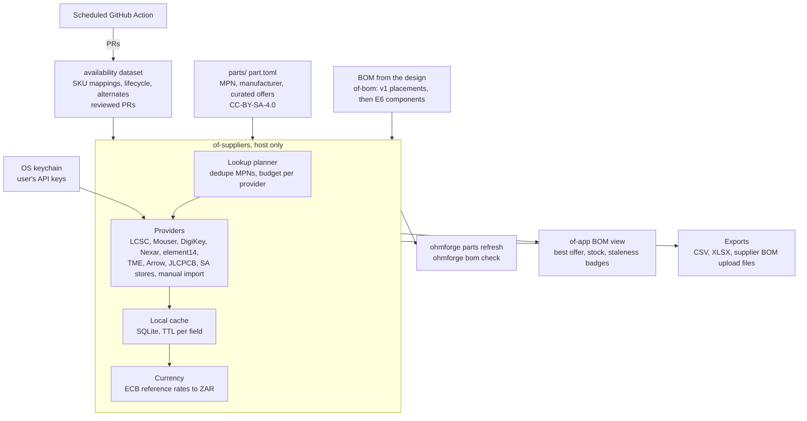

# Parts availability: keeping BOMs current

Status: proposed (design only, no code). Nothing in this document is implemented yet; section 1 lists what exists today. Phase A0 is this document (P2); A1 to A3 are planned in P3 / 0.2, A4 in P4 / 0.3 and A5 in P5 / 0.4, where it replaces the existing “Supplier price plugins for the BOM” item (section 8).
Date: 2026-11-23.
Related: [`DESIGN_AND_PLAN.md`](../DESIGN_AND_PLAN.md) §7 (component model and `part.toml`), §11 (bill of materials and build tracking), §13.1 (licensing); [`engine-components.md`](engine-components.md) §3g and phase E6 (parts library and BOM from components, #50); [`COMPONENTS.md`](../COMPONENTS.md); roadmap items “BOM v1” (P2, #59), “E6” (P3, #50) and “Supplier price plugins for the BOM” (P5).

Every Ohmforge part is meant to be a real, orderable part, so a design's BOM should say what it costs and whether it can be bought today. Prices, stock and lifecycle change weekly; the part definitions in `parts/` should not. This note plans a parts-availability service: supplier providers behind one trait, a local cache that works offline, an on-demand check from the CLI and the app, and a scheduled refresh. It never touches the simulation.

## 1. Current state

What exists on `main` (23 November 2026, `c466207`):

| Piece | Where it lives today | What it holds or does |
|---|---|---|
| `[[variant]]` in `part.toml` | `of-parts` (`Variant`: `label`, `mpn`, `manufacturer`, `footprint`, `offers`) | What you actually buy. Every library part except `parts/mcu/esp32-c3` has one variant with an MPN and manufacturer (for example `APT1608EC` / Kingbright, `PTV09A-4020F-B103` / Bourns, `AMS1117-3.3` / Advanced Monolithic Systems). The resistor uses a pattern MPN, `RC0603FR-07*L` (Yageo), with the value filled in per placement |
| Supplier offers | `of-parts` (`Offer`: `supplier`, `sku`; nothing else) | Only two parts list any: `ams1117` (`lcsc` `C6186`) and `bosch-bme280` (`lcsc` `C92489`, `mouser` `262-BME280`). No prices, stock, URLs, dates, lifecycle or alternates anywhere in the schema |
| `[license]` | `of-parts` (`PartLicense`), checked by `ohmforge validate-parts` | Part data and artwork are CC-BY-SA-4.0 |
| BOM model | `of-bom` (`BomLine`: `references`, `mpn`, `manufacturer`, `quantity`, `unit_price_zar_cents: Option<u64>`; `Bom::total_zar_cents`, `Bom::to_csv`) | A minimal line list with ZAR totals and a five-column CSV (`References,Manufacturer,MPN,Quantity,UnitPriceZAR`), one unit test. No crate depends on `of-bom` yet; nothing fills it from a design |
| BOM plans | Roadmap P2 “BOM v1” (#59: CSV from the demo boards' placements, excluding PSU1 and instruments); E6 (#50: BOM from the circuit's components, `bom = false` for bench equipment); P3 XLSX export; P5 “Supplier price plugins for the BOM” | `DESIGN_AND_PLAN.md` §11 already expects “dated price snapshots per supplier, with currency conversion and price breaks”, “optional supplier API plugins with the user's own keys”, substitutes, and LCSC, Mouser, DigiKey, RS plus Communica, DIYElectronics and Micro Robotics as offer entries |

What does not exist: any network code in the workspace, any supplier client, a price or stock store, currency conversion, lifecycle data, alternates, a BOM view in the app, or secret storage.

## 2. Goals and non-goals

Goals:

- **Current BOM facts.** For every BOM line: which suppliers stock it, stock quantity, minimum order and multiples, price breaks with currency, lead time, the product URL, the part's lifecycle (active, NRND, last-time-buy, EOL, obsolete) and known alternates.
- **On demand.** `ohmforge bom check` and an in-app “Check availability” refresh one BOM or one part when asked.
- **Scheduled.** A periodic refresh keeps the shared library honest (dead SKUs, EOL notices) and keeps a user's cache warm.
- **Local suppliers count.** South African stores (Pretoria and national) sit alongside the global distributors, and totals are in ZAR or the user's preferred currency.
- **Never blocks the simulation.** Lookups run in the host process off the simulation thread, with timeouts; simulation crates gain no dependency on this.
- **Offline first.** Everything works from the cache with the time each fact was fetched; staleness is shown, never hidden.
- **Within supplier terms.** Official APIs with the user's own keys, their rate limits honoured, and no scraping where terms forbid it.

Non-goals:

- Ordering or checkout from Ohmforge. Cart or BOM upload hands the list to the supplier's site; the user completes the order there.
- Ohmforge-operated servers or a hosted price database (it would need infrastructure and a billing model; see the parked “Cloud accounts” idea).
- Republishing supplier price and stock data (most API terms limit it; section 4).
- Rewriting `part.toml` automatically. Part definitions change through reviewed PRs only.
- Price prediction, purchasing optimisation across a whole order book, or parametric part search beyond finding alternates.

## 3. Architecture

**Proposed.**



### 3a. Crate and the provider trait

A new host-only crate, working name `of-suppliers`, owns providers, the cache and currency conversion. It depends on `of-parts` and `of-bom` (never the other way round), and on an HTTP client (`ureq` or `reqwest` with rustls), `rusqlite` and a keychain crate (all MIT or Apache-2.0, checked by `cargo-deny`). It is not built for `wasm32`; the web app (P4) can add a browser-side provider later if suppliers allow cross-origin calls. `of-bom` stays pure: it gains offer and price types but no I/O.

Provider trait (**illustrative, draft**):

```rust
// DRAFT: illustrative only, not a committed API.
pub trait SupplierProvider: Send + Sync {
    /// Stable key used in part.toml offers and the cache, e.g. "lcsc", "mouser", "communica".
    fn id(&self) -> &str;
    /// Regions, currencies and capabilities (MPN search, SKU lookup, lifecycle, batch size).
    fn capabilities(&self) -> &Capabilities;
    /// The provider's published limits, used by the planner to pace calls.
    fn limits(&self) -> &RateLimits;
    /// Look up a batch of parts by MPN (with manufacturer) or by the supplier's SKU.
    fn lookup(&self, req: &[PartQuery], creds: &Credentials) -> Result<Vec<SupplierRecord>, ProviderError>;
}
```

- **Providers as plugins.** Built-in providers are Rust modules in `of-suppliers`, each behind a cargo feature. A `manual` provider imports a CSV (or a supplier's exported cart or quote) the user saved, so a store without an API still gets dated offers. Third-party providers can come later as WASM modules with a host-provided, allow-listed HTTP function (the `of-plugin-wasm` sandbox has no network today, so this needs its own design); not before P6.
- **Lookup planner.** Collects the MPNs of a BOM, drops lines whose cached facts are still fresh, groups the rest into each provider's batch size, and spends no more than a per-provider budget (for example Mouser's 1,000 calls a day, section 4). Results arrive incrementally; a slow provider never holds up the others.

### 3b. Local cache

- SQLite (one file in the platform data directory, `%LOCALAPPDATA%\Ohmforge\availability.sqlite` on Windows, the XDG and macOS equivalents elsewhere), chosen over a file store because it gives atomic updates, concurrent readers (CLI and app at once) and cheap queries by MPN, and is public domain.
- Every fact has `fetched_at` (UTC) and its provider. **TTLs per field** (defaults, configurable): stock and price 24 h, lead time 7 days, lifecycle and alternates 30 days. Stale facts are kept and shown as stale, never deleted silently; `--max-age` and the app's badges use them.
- A cache export (`ohmforge parts export-cache`) for moving a cache between machines, not for publishing.

### 3c. Commands

| Command | What it does |
|---|---|
| `ohmforge bom check <project or circuit file> [--qty N] [--offline] [--max-age 24h]` | Builds the BOM (v1: a demo board; E6: any circuit file), refreshes stale facts, prints per line the best offer, stock, lifecycle and age, and exits non-zero on configurable problems (out of stock, EOL, stale beyond a limit), so CI can gate on it |
| `ohmforge parts refresh [parts/…] [--provider P]` | Refreshes the cache for library parts (or a subset), within each provider's budget |
| `ohmforge parts alternates <part id or MPN>` | Lists alternates from the dataset and from providers that offer them |
| `ohmforge parts import <file> --supplier <id>` | The manual provider: imports a CSV or a saved supplier quote |
| `ohmforge suppliers login <id>` / `logout` / `status` | Stores, removes and tests API keys in the OS keychain; shows remaining daily budget |

### 3d. In the app

A “Check availability” action in the BOM view (and on a part's info panel) runs the same planner on a background worker; badges show freshness (fresh, stale with age, never fetched, offline). The app may refresh stale facts once on launch if the user has opted in; it never refreshes on a timer while simulating unless asked.

### 3e. Scheduled refresh and where the data lives

**Decision: availability data does not live in `part.toml`.** Part definitions are CC-BY-SA-4.0 and reviewed; supplier prices and stock come under each supplier's API terms, which typically allow showing results to the requesting user but restrict storing or redistributing them (section 4). Mixing the two would put third-party data under a licence we cannot grant, and would churn reviewed part files daily. So the data is split three ways:

| Data | Where | Licence and review |
|---|---|---|
| Part identity: MPN, manufacturer, footprint, curated offers (`supplier` + `sku`, unchanged schema) | `parts/**/part.toml` | CC-BY-SA-4.0; normal PRs |
| Shareable availability facts: SKU mappings per supplier, lifecycle with a source and date (manufacturer PCN/EOL notices), alternates, SKU last-seen dates | A separate dataset, `availability/` beside `parts/` (one TOML file per part id), proposed as CC-BY-SA-4.0 for the facts we compile ourselves | Updated by reviewed PRs, including bot PRs |
| Prices, stock, price breaks, lead times | Each user's local cache only | Fetched with the user's own keys under the supplier's terms; never committed |

- **Scheduled CI job (A5).** A GitHub Action (weekly, plus manual dispatch) runs `ohmforge parts refresh` for the library with project keys for Mouser, DigiKey and LCSC that Stefan holds as GitHub Actions secrets (decided 23 November 2026, subject to each supplier's terms; section 9), and opens one PR that updates only the shareable facts: a SKU no longer found, a lifecycle change, a new alternate a provider reports. It never commits prices or stock. Whether this CI use, and committing SKU and lifecycle facts derived from a provider's API, is allowed depends on that provider's terms; checking them is an action item before A5, and providers whose terms do not allow it are excluded from the CI job (section 9).
- **Per user.** The app's opt-in refresh on launch and `ohmforge parts refresh` (which a user can put in their own scheduler) keep the local cache warm.

## 4. Providers

API facts below were checked on 23 November 2026 against the cited pages unless marked **unverified**. Terms change; each provider module records the terms version it was written against, and a terms review is part of adding or updating one.

### 4a. Global distributors and aggregators

| Provider | API and access | Limits and cost | Data of interest | Notes |
|---|---|---|---|---|
| **LCSC** | Products API (also cart, ordering, shipping); log in and apply for free access, credentials after review; key, nonce, timestamp and SHA-1 signature; IP whitelisting is mentioned ([LCSC API solutions](https://www.lcsc.com/agent/), [API docs](https://www.lcsc.com/docs/index.html), [OpenAPI](https://www.lcsc.com/docs/openapi/index.html)) | 1,000 searches a day, 200 a minute by default ([rate limits](https://www.lcsc.com/help-center/api/api-access-frequency)) | Stock, price breaks (USD, CNY, EUR, HKD), item details by LCSC number, keyword/MPN search | The older docs ask for company details and a business licence; whether hobbyist accounts are approved is **unverified**. Two library parts already carry LCSC SKUs |
| **JLCPCB parts** | Open-platform API, apply and create an app after approval; HMAC-SHA256 signature; component detail by LCSC code ([JLCPCB API platform](https://api.jlcpcb.com/docs/create-an-application), [signature](https://api.jlcpcb.com/docs/api-request-signature)) | **Unverified**; approval may weigh order history (third-party report) | Assembly-library stock and basic/extended status | Useful with the P3 JLCPCB BOM/CPL export; secondary to LCSC |
| **Mouser** | Search API, key requested through My Mouser, `apiKey` query parameter; keyword and part-number search, JSON ([Mouser Search API](https://www.mouser.com/api-search/), [API hub](https://www.mouser.com/en/api-hub/)) | Up to 50 results a call, 30 calls a minute, 1,000 a day (Mouser's Search API page) | Stock, price breaks, lead time, datasheet URL; lifecycle field **unverified** | Cart and order APIs need a separate key; ZAR pricing through the API **unverified** |
| **DigiKey** | Product Information API v4, OAuth 2.0 client credentials (token about 10 minutes), `ProductDetails` by MPN or DigiKey number, locale and currency headers ([documentation](https://developer.digikey.com/documentation), [2-legged flow](https://developer.digikey.com/tutorials-and-resources/oauth-20-2-legged-flow), [ProductSearch](https://developer.digikey.com/products/product-information-v4/productsearch)) | 120 requests a minute and 1,000 a day for Product Information; HTTP 429 with `Retry-After` beyond that | Stock, price breaks, product status (lifecycle), substitutes | A Create BOM API exists (10 a minute); whether `X-DIGIKEY-Locale-Currency: ZAR` is accepted is **unverified** |
| **Nexar (Octopart)** | GraphQL supply API; apps and part limits in the Nexar portal ([plans](https://nexar.com/compare-plans), [part limits](https://support.nexar.com/support/solutions/articles/101000476314-part-limits-and-how-they-work)) | Metered by parts returned, not requests: a free Evaluation app with a lifetime limit (100 parts on the plans page; the FAQ says 1,000), then paid Standard (2,000 a month) and Pro (15,000 a month), prices not published | Offers across many distributors in one call, including some regional sellers; lifecycle and similar parts only on some plans | Good for a one-off “who stocks this anywhere” lookup; too costly as the default refresh. Always set `limit` to avoid spending 10 parts per search |
| **Farnell / element14** | Product Search API (REST), key from the element14 Partner Portal; `term=manuPartNum:…`, `storeInfo.id` per region ([partner portal](https://partner.element14.com/), [description](https://partner.element14.com/docs/Product_Search_API_REST__Description)) | A “courtesy usage allowance”; exact numbers **unverified** | Stock, prices, product details; contract pricing with an extra customer ID and secret | The published `storeInfo.id` list has no South African store ([store ids](https://partner.element14.com/search_api/storeInfoid_Values)); whether `export.farnell.com` is the right store for ZA buyers is **unverified** |
| **Arrow** | Pricing & Availability API v4 (formerly Itemservice), login and API key; `search/token` and batch `search/list` (up to 1,000 lines) ([getting started](https://developers.arrow.com/api/index.php/site/page?view=gettingStarted), [pricing & availability](https://developers.arrow.com/api/index.php/site/page?view=Itemservice)) | **Unverified** | Stock by source, tiered resale prices | Lower priority for hobby quantities |
| **TME** | API v2; register at developers.tme.eu, create an app, private token linked to a tme.eu account; `Products/GetPricesAndStocks` for up to 50 symbols ([API v2 docs](https://developers.tme.eu/en/api-doc/v2), [terms 2026-07-01](https://developers.tme.eu/pdfs/en/terms_2026-07-01.pdf)) | The 2013 terms set 5 requests a second; the current terms defer to the documentation (**unverified** figure) | Stock, price breaks, currency per country | Ships to South Africa (**unverified**) |
| **RS Components (incl. RS South Africa)** | An account-gated API developer portal with pricing-and-availability products is visible ([RS API portal](https://api-portal.nonprod.rs-online.com/product)) | **Unverified** | Customer-specific price and stock | Not self-service as far as found; contact RS South Africa about `za.rs-online.com` access. Until then: manual import |

### 4b. South African suppliers

None of these publishes a documented public product API (search on 23 November 2026). Decided 23 November 2026: all five listed first (Micro Robotics, Communica, DIYElectronics, Mantech, RS South Africa) are to be asked for permission or a feed; none has been contacted yet, and manual CSV import covers them until then. The platform each store runs on was read from its public response headers or page markup and is noted only because it determines what an official feed could look like.

| Supplier | Site | Platform seen | Plan |
|---|---|---|---|
| **Micro Robotics** (Centurion, near Pretoria) | [robotics.org.za](https://www.robotics.org.za/) | OpenCart markers, behind Cloudflare | No API found. Ask for permission or a product feed (CSV or JSON); until then, manual import of a saved quote or cart. No automated fetching of the site |
| **Communica** | [communica.co.za](https://www.communica.co.za/collections/all) | Shopify | Shopify stores expose public storefront JSON, but using it at scale is the store's call: ask Communica for permission (or a feed) before any provider fetches it; manual import until then |
| **DIYElectronics** | [diyelectronics.co.za](https://www.diyelectronics.co.za/store/199-electronics) | PrestaShop | PrestaShop's webservice needs a key issued by the shop owner: ask; manual import until then |
| **Mantech** | [mantech.co.za](https://www.mantech.co.za/) | ASP.NET, Cloudflare bot check on automated requests | No API found; the bot check signals automated access is unwelcome. Manual import only, unless Mantech offers a feed |
| **RS South Africa** | `za.rs-online.com` | — | See RS above |
| **PartServe** | `api.partserve.co.za` | — | A search result shows a bearer-token product feed API; existence, access and terms **unverified**; worth contacting |

Rules for every provider: official APIs or written permission only; honour `robots.txt`, rate limits and `Retry-After`; identify the client (`User-Agent: Ohmforge/<version> (+repo URL)`); no CAPTCHA or bot-protection bypass; no fetching behind a login on the user's behalf. A supplier that says no gets the manual provider and a link.

### 4c. Keys

Users supply their own keys (`ohmforge suppliers login`, or a settings page in the app). Keys are stored in the OS keychain (Windows Credential Manager, macOS Keychain, Secret Service on Linux) through a keychain crate, never in project files, `config.toml`, the cache, logs or crash reports. A headless fallback reads environment variables (`OHMFORGE_MOUSER_API_KEY` and so on) for CI. The project's own keys for the scheduled job live only in GitHub Actions secrets and are never exposed to PRs from forks.

## 5. Data model

**Proposed.** Facts are keyed by (manufacturer, MPN), with the library part id when known.

```rust
// DRAFT: illustrative only, not a committed API.
pub struct PartAvailability {
    pub manufacturer: String,
    pub mpn: String,
    pub part_id: Option<String>,          // e.g. "generic.led-red-0603"
    pub lifecycle: Option<Fact<Lifecycle>>,
    pub offers: Vec<SupplierOffer>,
    pub alternates: Vec<Alternate>,
}

pub enum Lifecycle { Active, Nrnd, LastTimeBuy, Eol, Obsolete, Unknown }

pub struct SupplierOffer {
    pub supplier: String,                 // provider id, same keys as part.toml offers
    pub sku: String,
    pub url: Option<String>,
    pub stock: Option<u64>,
    pub moq: Option<u32>,
    pub multiple: Option<u32>,
    pub lead_time_days: Option<u32>,
    pub packaging: Option<String>,        // cut tape, reel, bag
    pub breaks: Vec<PriceBreak>,
    pub fetched_at: Timestamp,            // UTC
    pub source: Source,                   // provider API, manual import (file and date), dataset
}

pub struct PriceBreak {
    pub quantity: u32,
    pub unit_price: Money,                // as quoted, in the supplier's currency
}

pub struct Money { pub micros: i64, pub currency: Currency }  // millionths, so sub-cent prices are exact

pub struct Alternate {
    pub manufacturer: String,
    pub mpn: String,
    pub part_id: Option<String>,
    pub kind: AltKind,                    // DropIn (pin and footprint compatible), Footprint, Functional
    pub note: Option<String>,             // what differs (Vf, tolerance, temperature range)
    pub source: Source,
}
```

- **Money.** Integer millionths of the currency unit, not floats: resistor price breaks are often fractions of a cent. `of-bom`'s `unit_price_zar_cents` becomes a `Money` in the display currency, keeping today's CSV column.
- **Currency conversion.** Prices are stored as quoted; conversion happens at display and export, to the user's preferred currency (default ZAR). Rates come from the ECB's daily euro reference rates, which include ZAR, USD and CNY ([ECB daily XML](https://www.ecb.europa.eu/stats/eurofxref/eurofxref-daily.xml)), cached with their date; the BOM states the rate date. A supplier that quotes ZAR directly (the SA stores, possibly DigiKey or Mouser regional sites) is used as quoted. Duties, VAT and shipping are out of scope for the unit price; the BOM can add a user-set landed-cost factor per supplier (open question 2).
- **Alternates linked to `part.toml`.** An alternate that is itself a library part carries its `part_id`, so “use this instead” can swap the placement's variant and re-run the simulation with the substitute's own model. `DropIn` requires the same footprint string and pin mapping; `Footprint` the same footprint only; `Functional` neither (a reviewer's note says what changes). Alternates for library parts are curated in the `availability/` dataset; provider-reported substitutes (DigiKey, Nexar) are shown as unreviewed suggestions.
- **The resistor pattern.** Pattern MPNs such as `RC0603FR-07*L` expand per placement (`RC0603FR-0710KL` for 10 kΩ) before lookup; the expansion rule belongs with E6's `bom` fields.

## 6. BOM integration

**Proposed.**

- **BOM view** (CLI table and the app's BOM panel): per line the best offer for the build quantity (lowest extended cost among suppliers with enough stock; ties to the user's preferred suppliers; SA suppliers can be ranked first), stock, lifecycle, the offer's age, and a staleness badge. Totals per supplier and for a best-mix basket.
- **Warnings:** out of stock everywhere, stock below the build quantity, EOL, obsolete or last-time-buy, NRND (softer), a curated SKU no longer found, facts older than the configured limit, and no offer at all. `ohmforge bom check` turns these into exit codes for CI.
- **Find alternates:** from a warning, list alternates with their availability; picking a library alternate swaps the variant in the project (a project edit, not a `part.toml` edit) and marks the simulation results stale.
- **Exports:** CSV (today's columns plus supplier, SKU, URL, unit price with currency, extended price, stock, lifecycle and `fetched_at`) and XLSX (the P3 `rust_xlsxwriter` item) with one sheet per supplier. The export states the data date and that prices are indicative.
- **Supplier upload formats:** a per-supplier CSV in the layout each supplier's BOM or cart upload tool accepts (LCSC and DigiKey BOM tools, Mouser's cart import, JLCPCB's assembly BOM with LCSC part numbers), generated from the chosen offers. Formats are **unverified** and each needs a sample file in the tests; the API-based cart endpoints (LCSC cart, DigiKey Create BOM, Mouser cart) are possible later and always leave checkout to the user.

## 7. Invariants

1. **The simulation never waits.** No simulation crate depends on `of-suppliers`; lookups run on host worker threads with timeouts, and a failed or slow provider only changes a badge.
2. **Facts carry provenance.** Every price, stock figure, lifecycle and alternate has a source and a `fetched_at`; nothing is shown without its age.
3. **Offline works.** Every command has a cache-only mode, and the default falls back to it when the network or a provider is unavailable.
4. **No secrets on disk outside the keychain**, no keys in logs, project files or the repository.
5. **No supplier data committed** except the shareable facts in `availability/`, and only from providers whose terms allow it.
6. **Terms first.** A provider ships only with official API access or written permission, and paces itself within published limits.
7. **Determinism of outputs.** Given the same cache file and rates, the BOM view and exports are byte-identical (ordered maps, stable sorting), so they can have golden tests.

## 8. Phasing

Small PRs with tests; providers are tested against recorded responses (fixtures committed only when the provider's terms allow storing samples, otherwise synthetic fixtures with the same shape), never against live APIs in CI.

| Item | Phase | Work | Depends on | Acceptance criteria |
|---|---|---|---|---|
| **A0** Design | P2 (now) | This document; roadmap, README, mdBook and changelog pointers. | — | Reviewed and merged by Stefan. No code change. |
| **A1** Data model, cache and offline CLI | P3 | `Money`, `SupplierOffer`, `PriceBreak`, `Lifecycle`, `Alternate` in `of-bom` (pure); `of-suppliers` with the SQLite cache, TTLs, ECB rates and the manual provider; `ohmforge bom check --offline` and `ohmforge parts import`; the `availability/` dataset format with a validator in `validate-parts`. | BOM v1 (#59); E6 (#50) for circuit-file BOMs (demo boards until then) | A manual import of a saved quote for the dimmer's parts (R1, D1, RV1) produces a BOM table and CSV with ZAR totals, supplier columns and `fetched_at`; ages and stale badges follow the TTLs; golden test of the CSV from a fixed cache; no network code reached with `--offline`; wasm32 check of simulation crates unchanged. |
| **A2** First API providers and refresh | P3 | Provider trait, lookup planner with per-provider budgets and `Retry-After`; LCSC, Mouser and DigiKey providers; keychain-backed `ohmforge suppliers login/status`; `ohmforge parts refresh`. | A1 | Recorded-response tests per provider (parse, price breaks, currency, 429 handling); a library refresh with all three keys stays within each published daily limit (planner test); keys never appear in logs (test with a sentinel key). |
| **A3** In-app availability | P3, with the BOM view | “Check availability” and staleness badges in the app's BOM panel; opt-in refresh on launch; warnings for EOL, NRND, out of stock and stale. | A2; the app's BOM panel (BOM v1 / E6) | Refresh runs without changing the simulation's realtime factor (measured with the existing dimmer realtime report); offline start shows cached values with ages; warnings appear for a fixture EOL part. |
| **A4** More providers, alternates and supplier exports | P4 | Nexar, element14, TME, Arrow and JLCPCB providers (each after a terms review); `ohmforge parts alternates` and “find alternates” with variant swap; XLSX with supplier sheets; supplier BOM/cart upload CSVs. | A2, A3; P3 XLSX export | Each provider passes recorded-response tests and documents its terms version; swapping RV1 or D1 for a library alternate re-runs the demo with the substitute's model; each upload CSV matches a sample accepted by that supplier's upload tool (checked manually once, then golden-tested). |
| **A5** Scheduled service and SA suppliers (replaces the P5 “Supplier price plugins for the BOM” item) | P5 | Terms check for CI use of the project keys (Mouser, DigiKey, LCSC; held by Stefan as Actions secrets); the weekly GitHub Action that opens PRs to `availability/` (shareable facts only); providers for South African suppliers that grant permission or a feed (Micro Robotics, Communica, DIYElectronics, Mantech, RS South Africa, PartServe), manual import for the rest; SA-first ranking and ZAR-quoted offers; WASM provider plugins considered with the P6 SDK. | A2 to A4; each supplier's terms allowing the CI use; written permission or feeds from each SA supplier | The Action runs on a schedule and on dispatch, stays within budgets, opens at most one PR per run touching only `availability/`, and never runs with secrets on fork PRs; at least one SA supplier offer appears through an agreed channel with ZAR prices, and the rest through manual import. |

## 9. Risks and open questions

| Risk | Impact | Mitigation |
|---|---|---|
| API terms restrict caching, display or redistribution, or change | A provider must be dropped or limited; committed facts may need removing | Terms review per provider with the version recorded; prices and stock stay in the user's local cache; only shareable facts are committed, and only from allowed providers; providers behind feature flags |
| Access is gated (LCSC business details, JLCPCB approval, RS account) or paid (Nexar) | Hobbyist users cannot get keys | Several providers so no single one is required; manual import always works; Nexar only for on-demand lookups |
| Key leakage | A user's supplier account is misused | Keychain only; no keys in logs or exports; sentinel-key tests; CI secrets not exposed to fork PRs |
| Stale or wrong data (stock changes hourly; MPN matching errors) | A BOM looks buyable when it is not | Every value shows its age; exact MPN plus manufacturer matching; ambiguous matches listed, not chosen silently; “indicative” on exports |
| Data licensing of the shared dataset | Lifecycle or SKU facts derived from one provider's API may be that provider's data | Prefer manufacturer notices as lifecycle sources; record the source per fact; exclude providers whose terms forbid it |
| Budget exhaustion (1,000 calls a day on Mouser and DigiKey; Nexar part limits) | Refreshes stop mid-run | Planner budgets, batching, TTLs and incremental refresh; show remaining budget |
| Exchange rates and landed cost | ZAR totals mislead for imported parts | Rate date shown; optional per-supplier landed-cost factor; SA offers quoted in ZAR as they are |

Decided (23 November 2026, Stefan):

- **Project keys for the scheduled job.** Stefan holds project API keys for Mouser, DigiKey and LCSC as GitHub Actions secrets for the A5 job. This is subject to each supplier's terms allowing that use (a public library, run from CI): **action item** before A5, check and record each supplier's terms for this use, and leave a supplier out of the job if its terms do not allow it. The job still publishes only shareable facts (SKU liveness, lifecycle, alternates) to `availability/`, never prices or stock.
- **South African suppliers to approach first:** all five, Micro Robotics, Communica, DIYElectronics, Mantech and RS South Africa. Each is asked for permission or a product feed (no supplier has been contacted yet); until one agrees, its offers come in through manual CSV import. PartServe stays a later candidate.

Open questions:

1. **Shareable dataset licence and home.** `availability/` in this repository under CC-BY-SA-4.0 (proposed), or a separate repository so the weekly bot PRs do not clutter the code history? (Not decided yet.)
2. **Landed cost.** Show distributor prices plus a user-set factor for shipping, duties and VAT, or try to model DigiKey/Mouser free-shipping thresholds for South Africa? Proposal: factor only.
3. **Preferred-supplier policy.** Rank by lowest total, by SA-first, or by fewest suppliers (one order)? Proposal: user setting, default fewest suppliers with SA-first ties.
4. **Lifecycle source of truth** when providers disagree (one says NRND, another Active). Proposal: show both with sources; warn on the most severe.
5. **Web app.** Should `of-web` (P4) get availability at all, given most APIs do not allow browser-side calls with a secret? Proposal: cache import only.
6. **Offer entries in `part.toml`.** Keep curated `offers` there as today (the dataset adds to them), or move all SKU mappings to `availability/` and leave `part.toml` with MPN and manufacturer only? Proposal: keep `offers` for the one or two canonical SKUs; everything else in the dataset.
